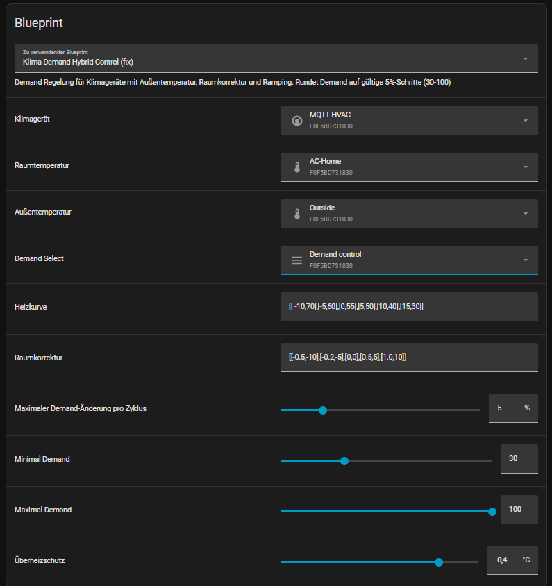

# Advanced Control for Several Automation Systems / Erweiterte Regelung für verschiedene Automationssysteme

[English](#english) | [Deutsch](#deutsch)

← [Back to overview / Zurück zur Übersicht](../README.md)

---

## English

*This guide is a best-effort introduction based on personal experience, including subjective impressions and assessments. It makes no claim to completeness or perfection and is offered as a helpful starting point.*

Advanced control scripts and integrations for automating Faikout-based Daikin systems beyond the built-in thermostat mode.

- [ioBroker](#iobroker)
- [Home Assistant](#home-assistant)

### ioBroker

Modern Daikin units support a **demand control** feature that allows the compressor output to be actively limited — a capability that is neither conveniently nor automatically usable through the standard Daikin interface, nor taken into account by the Faikout in any control loop. This script unlocks that potential from ioBroker.

The approach keeps the Faikout's Auto-Control running in thermostat mode as usual, handling on/off switching based on room temperature. On top of that, ioBroker continuously adjusts the unit's heating demand (compressor output in %) to achieve the smoothest and most efficient operation possible: the system runs longer at lower output rather than cycling on and off at full power.

The basis for the required heating output is a **characteristic curve (Heizkennlinie)** that maps the current outdoor temperature to a suitable demand value — modelling the individual heating load of the room. This curve can and should be adapted to suit your specific building, insulation, and exposure. Additional boost steps handle situations where the room falls significantly behind the target temperature.

> **Note:** This advanced control is designed exclusively for **heating mode** (mode H). The script activates automatically when the unit is running in heating mode and pauses in all other modes (cooling, fan, dry, auto).

#### Faikout Settings Used in This Setup

| Parameter | Value | Effect |
|---|---|---|
| `heatover` | 0°C | No overshoot added to the upper setpoint — Faikout heats exactly to `autot + autor`, no higher |
| `heatback` | 3°C | When idle, the Daikin target temp is set 3°C below the lower band edge — prevents brief re-triggering |
| `tempnoflap` | 0s | No minimum interval between setpoint changes — ioBroker demand updates take effect immediately |
| `lockmode` | active | Faikout thermostat never switches the unit from heat to cool mode automatically — mode control stays with the user |
| `thermostat` | active | Faikout thermostat mode enabled — the Faikout handles on/off switching based on room temperature |

#### Available Alias Data Points

All data points are created automatically by the [faikout-iobroker](https://codeberg.org/RaW07/faikout-iobroker) alias generator.

#### Installation

In the ioBroker Script Adapter, create a new JavaScript script and paste the script content. Only two things need to be adjusted in the configuration block at the top of the script:
- The **alias paths** under `ALIAS` and `SENSOR` — adapt to match your actual ioBroker alias structure.
- The **settings** such as setpoints, schedule times, and demand curve — adjust to your room and building.

Download: [Faikout-IOB-AdvancedV01_english.js](../iobroker/Faikout-IOB-AdvancedV01_english.js)

---

### Home Assistant

The Home Assistant implementation uses a **Blueprint** that creates an automation with the same core logic as the ioBroker script. It is designed to work with the MQTT HVAC integration provided by Faikout.

> **Note:** This Blueprint is currently in **Beta**. It covers the core demand control logic (outdoor curve, room correction, ramping, overheat protection) but does not yet include schedule-based on/off switching — use Home Assistant's native schedule automations for that.

> **Note:** This Blueprint is designed exclusively for **heating mode**. It only runs when the climate entity is in `heat` state.

#### Inputs

| Parameter | Description | Default |
|---|---|---|
| Klimagerät | Climate entity (MQTT HVAC) | — |
| Raumtemperatur | Room temperature sensor | — |
| Außentemperatur | Outdoor temperature sensor | — |
| Demand Select | Demand control select entity | — |
| Heizkurve | Outdoor curve as JSON array `[[outdoor_temp, demand], ...]` | `[[-10,70],[-5,60],[0,55],[5,50],[10,40],[15,30]]` |
| Raumkorrektur | Room correction curve as JSON array `[[diff, correction], ...]` | `[[-0.5,-10],[-0.2,-5],[0,0],[0.5,5],[1.0,10]]` |
| Maximaler Demand-Änderung pro Zyklus | Max demand change per cycle (ramping) | 5 % |
| Minimal Demand | Lower demand limit | 30 |
| Maximal Demand | Upper demand limit | 100 |
| Überheizschutz | Overheat threshold (Soll − Ist) | −0.4 °C |

The **Heizkurve** maps outdoor temperature to a base demand value and should be adapted to your building's heating load. The **Raumkorrektur** adds a correction based on how far the room temperature is from the setpoint. Ramping limits how fast the demand can change per cycle to avoid abrupt compressor steps.

#### Installation

1. In Home Assistant go to **Settings → Blueprints → Import Blueprint**
2. Use the raw file URL from Codeberg, or copy the YAML file manually to `/config/blueprints/automation/faikout/`
3. Reload Blueprints, then create a new automation from the Blueprint
4. Assign your Faikout entities and adjust curves to your setup

Download: [Faikout-HA-DemandHybridV01.yaml](../homeassistant/Faikout-HA-DemandHybridV01.yaml)

---

## Deutsch

*Dieser Leitfaden basiert auf persönlichen Erfahrungen und erhebt keinen Anspruch auf Vollständigkeit oder Fehlerfreiheit.*

Erweiterte Regelungsskripte und Integrationen zur Automatisierung Faikout-basierter Daikin-Systeme über den integrierten Thermostatmodus hinaus.

- [ioBroker](#iobroker-1)
- [Home Assistant](#home-assistant-1)

### ioBroker

Moderne Daikin-Geräte unterstützen eine **Bedarfsregelung (Demand Control)**, mit der die Kompressorleistung aktiv begrenzt werden kann – eine Funktion, die weder über die Standard-Daikin-Schnittstelle komfortabel und automatisiert nutzbar ist noch vom Faikout in eine Regelung berücksichtigt wird. Dieses Skript erschließt dieses Potenzial aus ioBroker heraus.

Der Ansatz lässt den Faikout-Auto-Control weiterhin im Thermostatmodus arbeiten – er übernimmt wie gewohnt das Ein- und Ausschalten auf Basis der Raumtemperatur. Zusätzlich passt ioBroker den Heiz-Demand (Kompressorleistung in %) kontinuierlich an, um einen möglichst gleichmäßigen und sparsamen Betrieb zu erreichen: Die Anlage läuft länger auf niedrigerer Leistung, anstatt mit voller Leistung zu takten.

Grundlage für den erforderlichen Heizbedarf ist eine **Heizkennlinie**, die die aktuelle Außentemperatur auf einen geeigneten Demand-Wert abbildet und damit den individuellen Wärmebedarf des Raumes nachbildet. Diese Kurve kann und sollte an das jeweilige Gebäude, die Dämmung und die Ausrichtung angepasst werden. Zusätzliche Boost-Stufen greifen ein, wenn die Raumtemperatur deutlich unter den Sollwert fällt.

> **Hinweis:** Diese erweiterte Regelung ist ausschließlich für den **Heizbetrieb** (Modus H) ausgelegt. Das Skript aktiviert sich automatisch, sobald das Gerät im Heizbetrieb läuft, und pausiert in allen anderen Modi (Kühlen, Lüften, Entfeuchten, Auto).

#### Verwendete Faikout-Einstellungen

| Parameter | Wert | Wirkung |
|---|---|---|
| `heatover` | 0°C | Kein Überschwingen am oberen Sollwert – Faikout heizt genau bis `autot + autor`, nicht darüber hinaus |
| `heatback` | 3°C | Im Ruhezustand wird der Daikin-Sollwert 3°C unter die untere Bandgrenze gesetzt – verhindert kurzzeitiges Wiedereinschalten |
| `tempnoflap` | 0s | Kein Mindestabstand zwischen Sollwertänderungen – ioBroker-Demand-Aktualisierungen wirken sofort |
| `lockmode` | aktiv | Der Faikout-Thermostat wechselt nie selbstständig von Heizen auf Kühlen – die Modussteuerung verbleibt beim Nutzer |
| `thermostat` | aktiv | Faikout-Thermostatmodus aktiv – der Faikout übernimmt das Ein- und Ausschalten auf Basis der Raumtemperatur |

#### Verfügbare Alias-Datenpunkte

Alle Datenpunkte werden automatisch durch den [faikout-iobroker](https://codeberg.org/RaW07/faikout-iobroker) Alias-Generator angelegt.

#### Installation

Im ioBroker Script-Adapter ein neues JavaScript-Skript anlegen und den Skriptinhalt einfügen. Im Konfigurationsbereich am Anfang des Skripts sind nur zwei Dinge anzupassen:
- Die **Alias-Pfade** unter `ALIAS` und `SENSOR` — an die eigene ioBroker-Alias-Struktur anpassen.
- Die **Einstellungen** wie Sollwerte, Zeitplanzeiten und Heizkennlinie — an Raum und Gebäude anpassen.

Download: [Faikout-IOB-AdvancedV01_german.js](../iobroker/Faikout-IOB-AdvancedV01_german.js)

---

### Home Assistant

Die Home-Assistant-Implementierung nutzt ein **Blueprint**, das eine Automation mit derselben Kernlogik wie das ioBroker-Skript erzeugt. Es ist für die MQTT-HVAC-Integration von Faikout ausgelegt.

> **Hinweis:** Dieses Blueprint befindet sich derzeit in der **Beta**. Es enthält die komplette Demand-Regelungslogik (Heizkennlinie, Raumkorrektur, Ramping, Überheizschutz), aber noch keine zeitplanbasierte Ein-/Ausschaltung — dafür die nativen Zeitplan-Automationen von Home Assistant nutzen.

> **Hinweis:** Dieses Blueprint ist ausschließlich für den **Heizbetrieb** ausgelegt. Es wird nur aktiv, wenn die Klimaentität im Zustand `heat` ist.

#### Eingaben

| Parameter | Beschreibung | Standard |
|---|---|---|
| Klimagerät | Klimaentität (MQTT HVAC) | — |
| Raumtemperatur | Raumtemperatursensor | — |
| Außentemperatur | Außentemperatursensor | — |
| Demand Select | Demand-Control-Select-Entität | — |
| Heizkurve | Außenkennlinie als JSON-Array `[[Außentemp, Demand], ...]` | `[[-10,70],[-5,60],[0,55],[5,50],[10,40],[15,30]]` |
| Raumkorrektur | Raumkorrekturkurve als JSON-Array `[[Diff, Korrektur], ...]` | `[[-0.5,-10],[-0.2,-5],[0,0],[0.5,5],[1.0,10]]` |
| Maximaler Demand-Änderung pro Zyklus | Maximale Demand-Änderung pro Zyklus (Ramping) | 5 % |
| Minimal Demand | Untere Demand-Grenze | 30 |
| Maximal Demand | Obere Demand-Grenze | 100 |
| Überheizschutz | Überheizschutz-Schwelle (Soll − Ist) | −0,4 °C |

Die **Heizkurve** bildet die Außentemperatur auf einen Basis-Demand-Wert ab und sollte an den Wärmebedarf des eigenen Gebäudes angepasst werden. Die **Raumkorrektur** addiert einen Aufschlag je nach Abweichung der Raumtemperatur vom Sollwert. Das Ramping begrenzt, wie schnell sich der Demand pro Zyklus ändern darf, um abrupte Kompressorsprünge zu vermeiden.

#### Installation

1. In Home Assistant unter **Einstellungen → Blueprints → Blueprint importieren**
2. Die Raw-URL von Codeberg verwenden, oder die YAML-Datei manuell nach `/config/blueprints/automation/faikout/` kopieren
3. Blueprints neu laden, dann eine neue Automation aus dem Blueprint erstellen
4. Faikout-Entitäten zuweisen und Kurven an das eigene Setup anpassen

Download: [Faikout-HA-DemandHybridV01.yaml](../homeassistant/Faikout-HA-DemandHybridV01.yaml)

