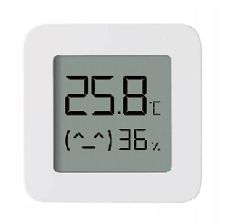
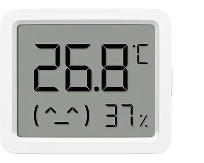

# External BLE Temperature Sensors – Flashing Guides

**LYWSD03MMC:** [English](#english) | [Deutsch](#deutsch)

**MJWSD06MMC:** [English](#mjwsd06mmc-english) | [Deutsch](#mjwsd06mmc-deutsch)

← [Back to overview / Zurück zur Übersicht](../README.md)

---

## English

*This guide is a best-effort introduction based on personal experience, including subjective impressions and assessments. It makes no claim to completeness or perfection and is offered as a helpful starting point.*

This guide describes how to flash a **Xiaomi Mijia Temperatur Monitor 2 (LYWSD03MMC)** with FW > 2.x with custom ATC firmware to use it as an external BLE temperature sensor with the Faikout.

> **Before you start:** This process can be fiddly and confusing, especially on the first run. A total time of **45 minutes to 1 hour** for a complete first attempt is perfectly normal. Rushing is strongly discouraged – moving too fast risks making the sensor completely unreachable via Bluetooth. A hardware flash via soldered cable connection (USB-TTL adapter and resistor network required) is however always possible and can be performed directly in the target firmware.

### What you need
- Xiaomi Mijia Temperatur Monitor 2 (LYWSD03MMC)
- Smartphone with **Xiaomi Home** app
- Windows PC with [Xiaomi Token Extractor](https://github.com/PiotrMachowski/Xiaomi-cloud-tokens-extractor)
- [pvvx TelinkMiFlasher](https://pvvx.github.io/ATC_MiThermometer/TelinkMiFlasher.html) · Source: [pvvx/ATC_MiThermometer](https://github.com/pvvx/ATC_MiThermometer)
- **Chrome recommended, personally tested** (Web Bluetooth required). Other Chromium-based browsers such as Edge or Opera should also work but have not been tested. To read the MAC address, `#enable-experimental-web-platform-features` must be enabled.

### Step 1 – Register in Xiaomi Home
Add the sensor to the Xiaomi Home app and assign it to your account.

### Step 2 – Read device credentials
Launch the [Xiaomi Token Extractor](https://github.com/PiotrMachowski/Xiaomi-cloud-tokens-extractor) and log in.

> **Tip:** Use the **QR code login** – more convenient and avoids Xiaomi's rate limiting (username/password login gets blocked for a period after ~5 attempts).

Note down for your sensor:
- **Device ID**
- **Mi Token**
- **Mi Bind Key**

Keep the extractor open – the credentials are needed in the next step.

### Step 3 – Flash custom firmware
Open [pvvx TelinkMiFlasher](https://pvvx.github.io/ATC_MiThermometer/TelinkMiFlasher.html) in Chrome.

1. Click **Connect** and search for `LYWSD03MMC`
2. Enter Device ID, Mi Token and Mi Bind Key
3. Click **Do Activation** – the flasher handles the unlock process internally
4. Flash the custom firmware (offered directly on the page as a button, e.g. `ATC_v59.bin`)

> **Note:** Bluetooth detection can take a long time – be patient. Battery level should be at least 40% for reliable flashing.

> **HW version B1.5 / B1.6 (delivered as standard since approx. March 2025):** An additional intermediate step is required. Before flashing the custom firmware, first flash `Original_OTA_Xiaomi_LYWSD03MMC_v2.1.1_0159c.bin` (available in the [pvvx repository](https://github.com/pvvx/ATC_MiThermometer)). The display will be temporarily inactive after this step – this is expected. After flashing the custom ATC firmware the display works again.

### Step 4 – Configure (optional)
Reconnect via the pvvx flasher for optional settings. Recommended:
1. Click **Receive Configuration**
2. Enable **Show Batt** – alternates battery status with room humidity on the display
3. Click **Send Configuration**

### Done
The sensor now appears as `ATC_XXXXXX` and is ready for use as an external BLE temperature sensor with the Faikout.

---

## Deutsch

*Diese Beschreibung entstand nach bestem Wissen und Gewissen inklusive möglicher subjektiver Erfahrungen und Wertungen. Sie erhebt keinen Anspruch auf Vollständigkeit oder Perfektion und versteht sich als Angebot zur Orientierung.*

Diese Anleitung beschreibt, wie ein **Xiaomi Mijia Temperatur Monitor 2 (LYWSD03MMC)** mit FW > 2.x mit einer Custom-ATC-Firmware geflasht wird, um ihn als externen BLE-Temperatursensor mit dem Faikout zu nutzen.

> **Bevor du anfängst:** Dieser Vorgang kann frickelig und verwirrend sein, insbesondere beim ersten Durchlauf. Für eine vollständige Erstdurchführung ist ein Zeitaufwand von **45 Minuten bis 1 Stunde** durchaus normal. Von überhasteten Schnellschüssen ist dringend abzuraten – wer zu schnell vorgeht, riskiert den Sensor über Bluetooth komplett unerreichbar zu machen. Ein Hardware-Flash per angelöteter Kabelverbindung (USB-TTL-Wandler und Widerstandsnetzwerk notwendig) ist jedoch jederzeit möglich und kann direkt in der Zielfirmware ausgeführt werden.

### Was du brauchst

- Xiaomi Mijia Temperatur Monitor 2 (LYWSD03MMC)
- Smartphone mit **Xiaomi Home** App
- Windows-PC mit [Xiaomi Token Extractor](https://github.com/PiotrMachowski/Xiaomi-cloud-tokens-extractor)
- [pvvx TelinkMiFlasher](https://pvvx.github.io/ATC_MiThermometer/TelinkMiFlasher.html) · Quelle: [pvvx/ATC_MiThermometer](https://github.com/pvvx/ATC_MiThermometer)
- **Chrome empfohlen, von mir getestet** (Web-Bluetooth erforderlich). Andere Chromium-basierte Browser wie Edge oder Opera sollten ebenfalls funktionieren, wurden aber nicht getestet. Zum Auslesen der MAC-Adresse muss `#enable-experimental-web-platform-features` aktiviert sein.

### Schritt 1 – In Xiaomi Home registrieren

Den Sensor in der Xiaomi Home App einbinden und dem eigenen Account zuweisen.

### Schritt 2 – Gerätedaten auslesen
Den [Xiaomi Token Extractor](https://github.com/PiotrMachowski/Xiaomi-cloud-tokens-extractor) starten und einloggen.

> **Tipp:** Den **QR-Code-Login** verwenden – komfortabler und vermeidet Xiaomis Rate-Limiting (Benutzername/Passwort wird nach ca. 5 Vorgängen für eine Zeit gesperrt).

Für den Sensor notieren:
- **Device ID**
- **Mi Token**
- **Mi Bind Key**

Den Extractor offen lassen – die Daten werden im nächsten Schritt benötigt.

### Schritt 3 – Custom-Firmware flashen
[pvvx TelinkMiFlasher](https://pvvx.github.io/ATC_MiThermometer/TelinkMiFlasher.html) in Chrome öffnen.

1. **Connect** klicken und nach `LYWSD03MMC` suchen
2. Device ID, Mi Token und Mi Bind Key eintragen
3. **Do Activation** klicken – der Flasher übernimmt den Entsperrvorgang intern
4. Finale Firmware flashen (wird auf der Seite direkt als Button angeboten, z.B. `ATC_v59.bin`)

> **Hinweis:** Die Bluetooth-Erkennung kann sehr lange dauern – Geduld mitbringen. Der Akkustand sollte für einen zuverlässigen Flash mindestens 40 % betragen.

> **HW-Version B1.5 / B1.6 (wird seit ca. März 2025 standardmäßig geliefert):** Ein zusätzlicher Zwischenschritt ist erforderlich. Vor der Custom-Firmware zunächst `Original_OTA_Xiaomi_LYWSD03MMC_v2.1.1_0159c.bin` flashen (im [pvvx-Repository](https://github.com/pvvx/ATC_MiThermometer) verfügbar). Das Display ist nach diesem Schritt vorübergehend inaktiv – das ist normal. Nach dem Flash der ATC-Firmware läuft es wieder.

### Schritt 4 – Konfigurieren (optional)
Über den pvvx-Flasher erneut verbinden für optionale Einstellungen. Empfohlen:
1. **Receive Configuration** klicken
2. **Show Batt** aktivieren – zeigt im Display im Wechsel mit der Raumfeuchte den Batteriestatus
3. **Send Configuration** klicken

### Fertig
Der Sensor erscheint nun als `ATC_XXXXXX` und ist als externer BLE-Temperatursensor mit dem Faikout einsatzbereit.

---

## Xiaomi Mijia T&H Monitor 3 Mini – Chinese Version (MJWSD06MMC) Flashing Guide

## English

*This guide is a best-effort introduction based on personal experience, including subjective impressions and assessments. It makes no claim to completeness or perfection and is offered as a helpful starting point.*

This guide describes how to flash a **Xiaomi Mijia T&H Monitor 3 Mini – Chinese Version (MJWSD06MMC)** with custom ATC firmware to use it as an external BLE temperature sensor with the Faikout.

> ⚠️ **Important – No OTA flashing possible:** Based on personal experience, no OTA (Over-The-Air) flashing method currently works reliably for this device. All known OTA approaches have failed. **Hardware flashing via USB TTL adapter and resistor network is the only confirmed working method.**

### What you need
- Xiaomi Mijia T&H Monitor 3 Mini – Chinese Version (MJWSD06MMC)
- USB TTL adapter (3.3 V)
- Resistor network to SWS for connecting RX & TX
- PC with Chrome (Web USB required)
- [pvvx USBCOMFlashTx – USB COM Flasher](https://pvvx.github.io/ATC_MiThermometer/USBCOMFlashTx.html)
- MJ06 ATC firmware binary from [pvvx/ATC_MiThermometer/tree/master/bin](https://github.com/pvvx/ATC_MiThermometer/tree/master/bin)

### Procedure

Hardware flashing requires physical access to the device's serial test pads (V=VCC, G=GND, S=SWS). Connect the USB TTL adapter as follows: VCC = 3.3 V · SWS = TX → direct connection · RX → through resistor (e.g. 1 kΩ). Then:

1. Open [USBCOMFlashTx](https://pvvx.github.io/ATC_MiThermometer/USBCOMFlashTx.html) in Chrome
2. Connect the USB TTL adapter and select the COM port
3. Select the MJ06 ATC firmware binary
4. Click **Write to Flash** and within the selected activation period reconnect VCC to power up the device
5. Wait for the flash to complete

### Done
The sensor appears as `ATC_XXXXXX` and is ready for use as an external BLE temperature sensor with the Faikout.

### Configuration (optional)
For detailed configuration (e.g. battery level display), connect to the sensor via BLE using [pvvx TelinkMiFlasher](https://pvvx.github.io/ATC_MiThermometer/TelinkMiFlasher.html), click **Get Config**, make your selections and apply with **Set Config**.

> **Tip:** To improve battery life for Faikout usage, reduce the advertising interval from the default 2.5 s to 10 s.

---

## Xiaomi Mijia T&H Monitor 3 Mini – Chinesische Version (MJWSD06MMC) Flashing Guide

## Deutsch

*Diese Beschreibung entstand nach bestem Wissen und Gewissen inklusive möglicher subjektiver Erfahrungen und Wertungen. Sie erhebt keinen Anspruch auf Vollständigkeit oder Perfektion und versteht sich als Angebot zur Orientierung.*

Diese Anleitung beschreibt, wie ein **Xiaomi Mijia T&H Monitor 3 Mini – Chinesische Version (MJWSD06MMC)** mit einer Custom-ATC-Firmware geflasht wird, um ihn als externen BLE-Temperatursensor mit dem Faikout zu nutzen.

> ⚠️ **Wichtig – Kein OTA-Flash möglich:** Nach eigener Erfahrung funktioniert aktuell kein OTA-Verfahren (Over-The-Air) zuverlässig für dieses Gerät. Alle bekannten OTA-Ansätze sind fehlgeschlagen. **Der Hardware-Flash per USB-TTL-Wandler und Widerstandsnetzwerk ist die einzige bestätigte Methode.**

### Was du brauchst
- Xiaomi Mijia T&H Monitor 3 Mini – Chinesische Version (MJWSD06MMC)
- USB-TTL-Wandler (3,3 V)
- Widerstandsnetzwerk an SWS für die Verbindung von RX & TX
- PC mit Chrome (Web USB erforderlich)
- [pvvx USBCOMFlashTx – USB COM Flasher](https://pvvx.github.io/ATC_MiThermometer/USBCOMFlashTx.html)
- MJ06 ATC Firmware-Binary unter [pvvx/ATC_MiThermometer/tree/master/bin](https://github.com/pvvx/ATC_MiThermometer/tree/master/bin)

### Vorgehen

Der Hardware-Flash erfordert physischen Zugang zu den seriellen Testpads des Geräts (V=VCC, G=GND, S=SWS). USB-TTL-Wandler wie folgt verbinden: VCC = 3,3 V · SWS = TX → direkte Verbindung · RX → über Widerstand (z.B. 1 kΩ). Dann:

1. [USBCOMFlashTx](https://pvvx.github.io/ATC_MiThermometer/USBCOMFlashTx.html) in Chrome öffnen
2. USB-TTL-Wandler anschließen und COM-Port auswählen
3. MJ06 ATC Firmware-Binary auswählen
4. **Write to Flash** klicken und innerhalb des gewählten Aktivierungszeitraums VCC wieder anlegen um das Gerät zu starten
5. Warten bis der Flash-Vorgang abgeschlossen ist

### Fertig
Der Sensor erscheint nun als `ATC_XXXXXX` und ist als externer BLE-Temperatursensor mit dem Faikout einsatzbereit.

### Konfiguration (optional)
Für eine detaillierte Konfiguration (z.B. Akkustandsanzeige) den Sensor nach erfolgreichem Flash per BLE über den [pvvx TelinkMiFlasher](https://pvvx.github.io/ATC_MiThermometer/TelinkMiFlasher.html) verbinden, **Get Config** klicken, Einstellungen vornehmen und mit **Set Config** übernehmen.

> **Tipp:** Für den Einsatz mit dem Faikout empfiehlt es sich, das Advertising-Intervall vom Standard 2,5 s auf 10 s zu erhöhen – das verlängert die Akkulaufzeit deutlich.
