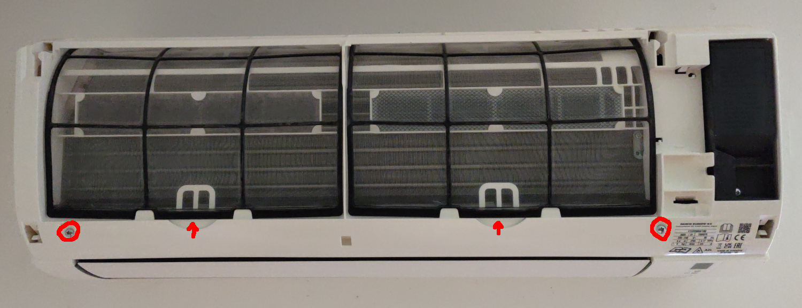
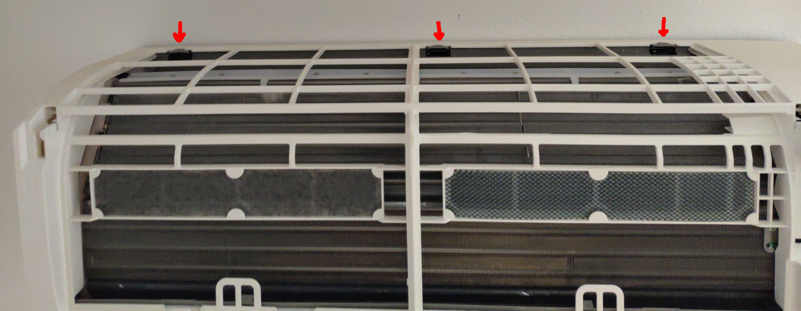
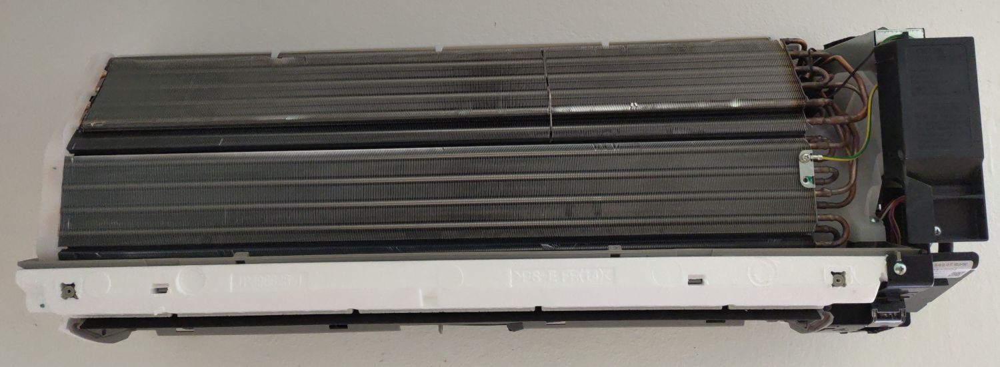
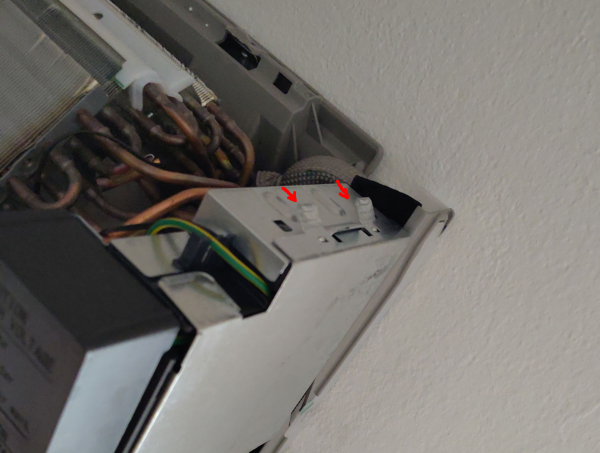
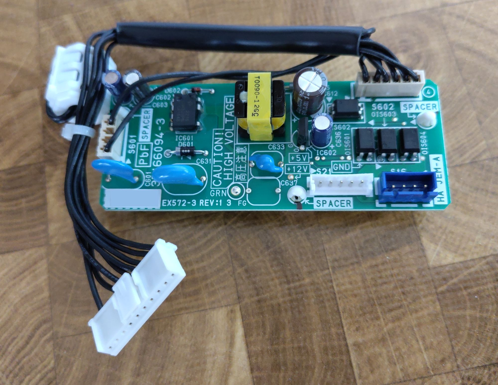
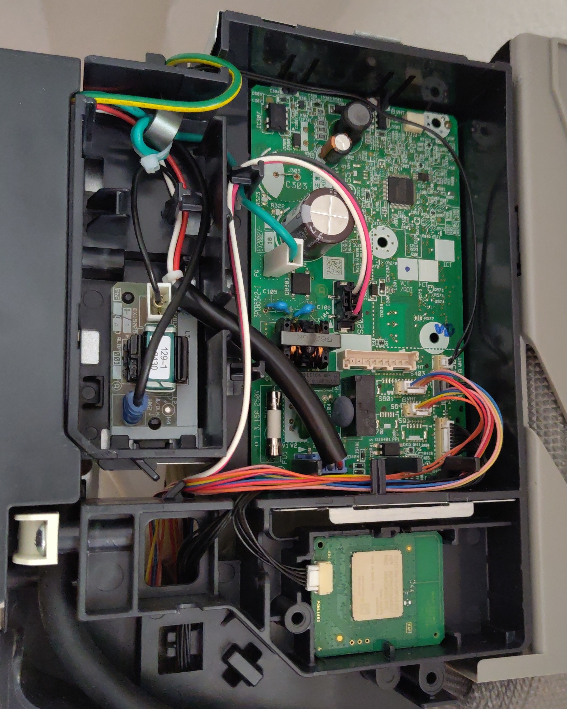
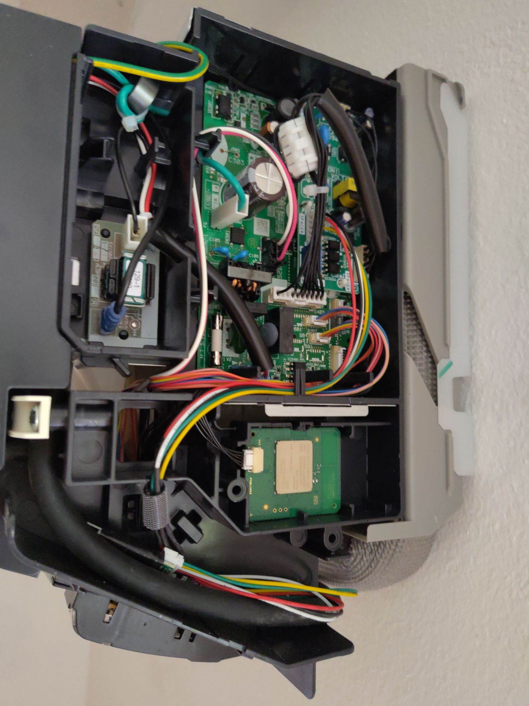

# Daikin Comfora – Disassembly & Installation / Montagehinweise

[English](#english) | [Deutsch](#deutsch)

← [Back to overview / Zurück zur Übersicht](../README.md)

---

## English

*These hints are based on community experience and are provided as a helpful starting point. Always switch off the unit and disconnect the power before opening any housing.*

> **⚠️ Safety first:** Turn off all indoor units and unplug the outdoor unit or trip the circuit breaker before starting any work.
>
> **⚠️ No galvanic isolation:** The S403 connector has no galvanic isolation. The connector permanently carries a pin at mains voltage. In a fault condition, mains voltage can additionally be present on the Faikout board. **Do not touch the Faikout or the connector while the unit is powered. Risk to life.**

Applies to: FTXP20N, FTXP25N, FTXP35N, FTXP50N, FTXP60N, FTXP71N, ATXP20N, ATXP25N, ATXP35N.  
Cable type: **JST XAP / S403** (Type D) – or **JST EHR / S21** (Type A) when using the KRP067A41 adapter board.

> Note: The Comfora uses the S403 service connector (JST XAP / S403, Type D). As an alternative, the **KRP067A41 adapter board** (Daikin accessory) can be installed on the main board, which then provides a JST EHR / S21 interface (Type A). A 50 cm EHR-5 cable connects it to the Faikout. **The adapter is also recommended from a safety perspective**, as it exposes an S21 interface with galvanic isolation, eliminating the mains voltage risk present on the S403 connector.

### Opening the unit

1. **Lid and filters** - Swing the lid upward, unhook and remove the filters as described in the consumer manual.
2. **Front panels** - Two screws (PH2), one on each side. Bend the air flap into an S-shape to get it out of the way.

   

3. **Main casing** - Three grey hooks on the back plate, same technique as the Perfera: pull upward.

   

4. **Electrical box cover** - Held by spring-loaded clips. Press and lift to open.

    

5. **KRP067A41 adapter (if used)** - Insert the three included plastic spacers first, then seat the adapter board on the main board connector. Connect the EHR-5 cable.

    

6. **Cable routing** - Leave the ferrite core cable hanging freely. Tuck the Faikout board beside the power cable before closing.

   

### Closing the unit

Reassemble in reverse. Check that the electrical box cover clips are fully engaged and the front panel screws are snug.

*Photos: www.yepoleb.at / Gabriel Huber*

---

## Deutsch

*Diese Hinweise basieren auf Erfahrungen aus der Community und dienen als hilfreiche Orientierung. Vor dem Öffnen des Geräts immer Strom abschalten und Außengerät vom Netz trennen.*

> **⚠️ Sicherheit zuerst:** Alle Innengeräte ausschalten und das Außengerät vom Strom trennen (Stecker ziehen oder Sicherungsautomat abschalten), bevor mit der Arbeit begonnen wird.
>
> **⚠️ Keine galvanische Trennung:** Der S403-Anschluss bietet keine galvanische Trennung. An der Buchse liegt dauerhaft ein Pin mit Netzspannung an. Im Fehlerfall kann Netzspannung zusätzlich am Faikout-Board anliegen. **Kein Kontakt zum Faikout oder zur Buchse bei aktiver Spannungsversorgung. Lebensgefahr.**

Gilt für: FTXP20N, FTXP25N, FTXP35N, FTXP50N, FTXP60N, FTXP71N, ATXP20N, ATXP25N, ATXP35N.  
Kabeltyp: **JST XAP / S403** (Typ D) - oder **JST EHR / S21** (Typ A) bei Verwendung des KRP067A41-Adapterboards.

> Hinweis: Die Comfora nutzt den S403-Serviceanschluss (JST XAP / S403, Typ D). Alternativ kann das **KRP067A41-Adapterboard** (Daikin-Zubehör) auf das Hauptboard gesteckt werden, das dann eine JST-EHR / S21-Schnittstelle (Typ A) bereitstellt. Ein 50-cm-EHR-5-Kabel verbindet es mit dem Faikout. **Der Adapter wird auch aus Sicherheitsgründen empfohlen**, da er einen S21-Anschluss mit galvanischer Trennung bereitstellt und damit das Netzspannungsrisiko des S403-Anschlusses entfällt.

### Gehäuse öffnen

1. **Deckel und Filter** - Deckel nach oben schwenken, Filter wie in der Bedienungsanleitung beschrieben aushaken und entnehmen.
2. **Frontverkleidungen** - Zwei Schrauben (PH2), je eine auf jeder Seite. Die Luftklappe in eine S-Form biegen, um sie aus dem Weg zu bringen.

   

3. **Hauptgehäuse** - Drei graue Haken an der Rückplatte, gleiche Technik wie bei der Perfera: nach oben ziehen.

   

4. **Elektrokasten-Abdeckung** - Wird von Federklammern gehalten. Drücken und anheben zum Öffnen.

    

5. **KRP067A41-Adapter (falls verwendet)** - Zunächst die drei beiliegenden Kunststoffabstandshalter einsetzen, dann das Adapterboard auf den Hauptboard-Stecker aufstecken. EHR-5-Kabel anschließen.

    

6. **Kabelführung** - Das Ferritkern-Kabel frei hängen lassen. Das Faikout-Board neben dem Stromkabel verstauen, bevor geschlossen wird.

   

### Gehäuse schließen

In umgekehrter Reihenfolge zusammenbauen. Sicherstellen, dass die Federklammern der Elektrokasten-Abdeckung vollständig einrasten und die Frontschrauben fest sitzen.

*Fotos: www.yepoleb.at / Gabriel Huber*
