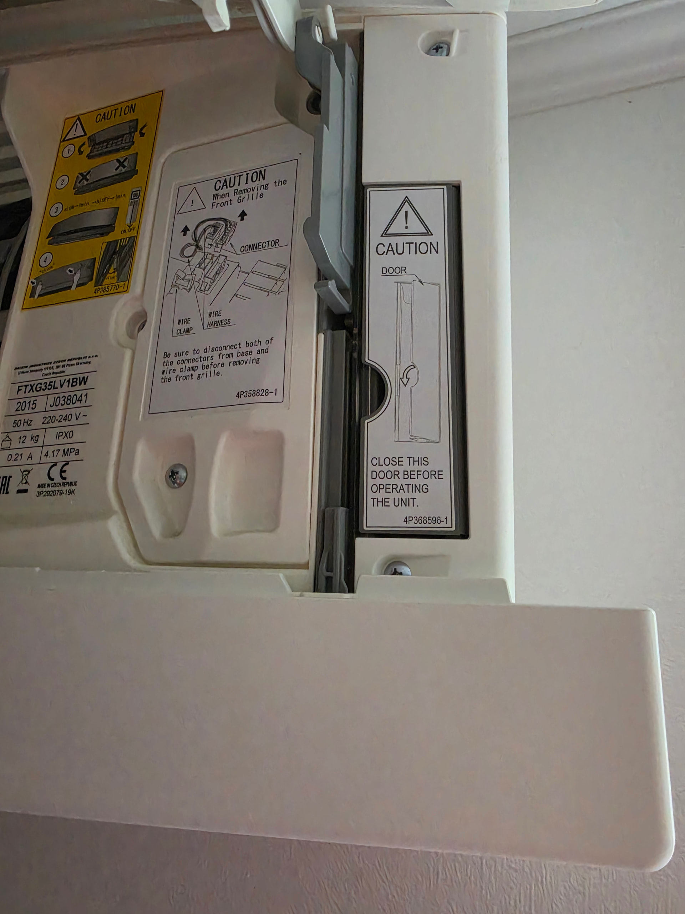
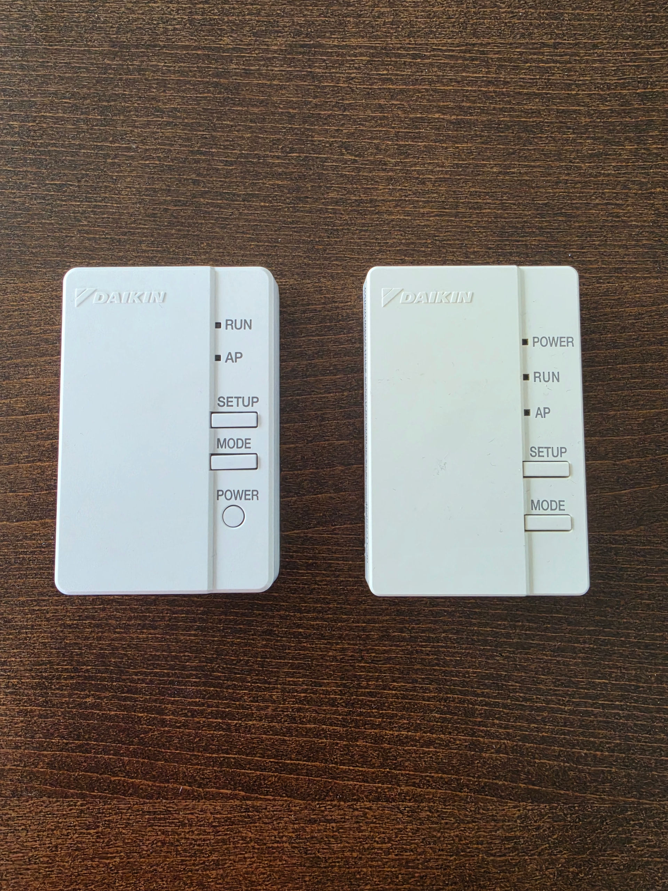
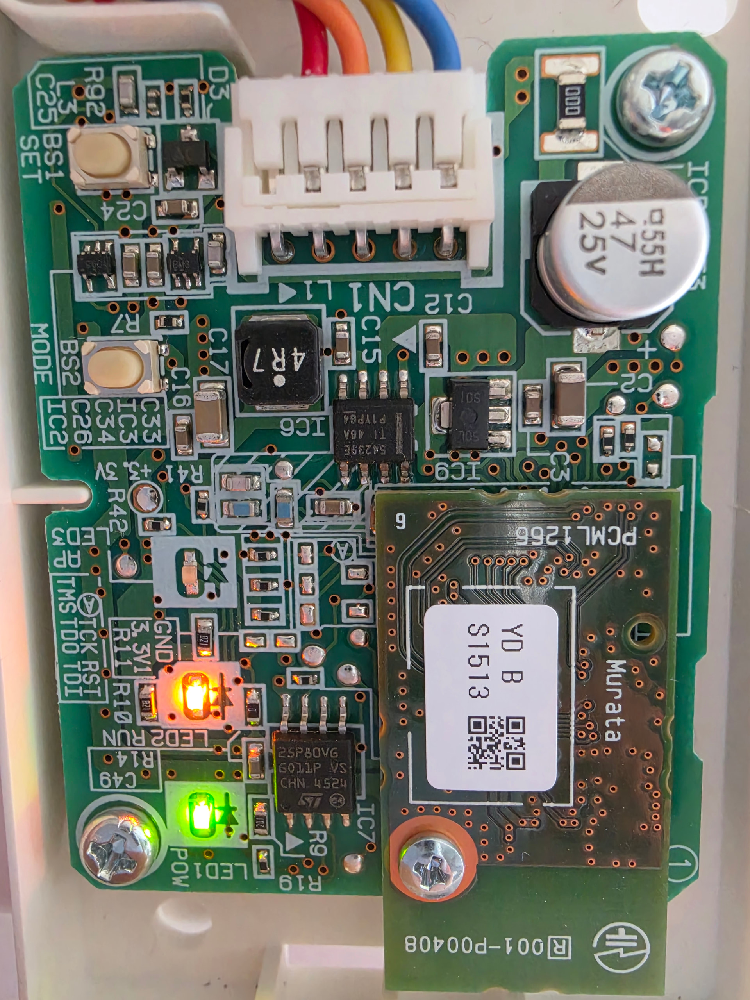
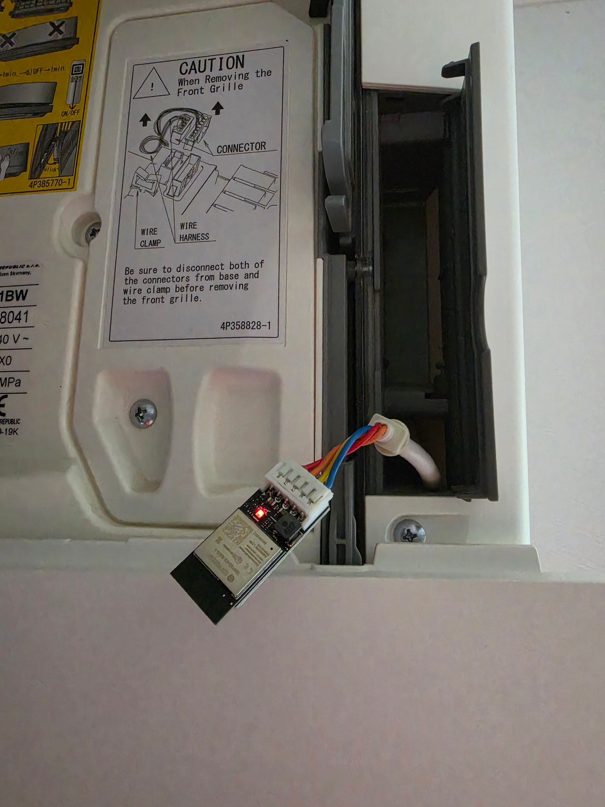

# Daikin Emura 2 – Disassembly & Installation / Montagehinweise

[English](#english) | [Deutsch](#deutsch)

← [Back to overview / Zurück zur Übersicht](../README.md)

---

## English

*These hints are based on community experience and are provided as a helpful starting point. Always switch off the unit and disconnect the power before opening any housing.*

> **⚠️ Safety first:** Turn off all indoor units and unplug the outdoor unit or trip the circuit breaker before starting any work.

Applies to: FTXJ35MV1BW (2021), FTXG35LV1BW (2015) and similar Emura 2 models.  
Cable type: **Premounted cable / JST EH** (Type A).

The Emura 2 has a dedicated WLAN module compartment - no housing removal needed.

### Installation

1. **Open the front flap** - The right side has a compartment designed for WLAN controllers.

   

2. **Remove the existing controller** - Pull it out from the upper corner and disconnect the communication cable from the lower side.

   

3. **Open the original controller** - It is either screwed or clipped. Open it carefully without damaging the cable.

   

4. **Connect the Faikout** - Disconnect the cable from the original controller and connect it to the Faikout. Note: blue wire to PIN 5.

   

5. **Insert the Faikout** into the compartment and close the front flap.

*Photos: Thanks to Witti*

---

## Deutsch

*Diese Hinweise basieren auf Erfahrungen aus der Community und dienen als hilfreiche Orientierung. Vor dem Öffnen des Geräts immer Strom abschalten und Außengerät vom Netz trennen.*

> **⚠️ Sicherheit zuerst:** Alle Innengeräte ausschalten und das Außengerät vom Strom trennen (Stecker ziehen oder Sicherungsautomat abschalten), bevor mit der Arbeit begonnen wird.

Gilt für: FTXJ35MV1BW (2021), FTXG35LV1BW (2015) und ähnliche Emura-2-Modelle.  
Kabeltyp: **Vorinstalliertes Kabel / JST EH** (Typ A).

Die Emura 2 hat ein eigenes Fach für WLAN-Module - kein Gehäuseausbau nötig.

### Einbau

1. **Frontklappe öffnen** - Rechts befindet sich ein Fach, das speziell für WLAN-Controller vorgesehen ist.

   

2. **Vorhandenen Controller entnehmen** - Aus der oberen Ecke herausziehen und das Kommunikationskabel von der Unterseite abziehen.

   

3. **Originalcontroller öffnen** - Ist verschraubt oder geclipst. Vorsichtig öffnen ohne das Kabel zu beschädigen.

   

4. **Faikout anschließen** - Kabel vom Originalcontroller abziehen und am Faikout anschließen. Hinweis: blaues Kabel an PIN 5.

   

5. **Faikout ins Fach einsetzen** und Frontklappe schließen.

*Fotos: Thanks to Witti*

---

<small><em>All information is provided for educational purposes based on community experience. No liability is accepted for errors, omissions, or any damage resulting from the use of this information. Always follow applicable local regulations, standards, and safety requirements. Work on electrical installations must only be carried out by qualified personnel. / Alle Informationen basieren auf Erfahrungen aus der Community und dienen ausschließlich zu Informationszwecken. Es wird keine Haftung für Fehler, Auslassungen oder Schäden übernommen, die aus der Nutzung entstehen. Einschlägige lokale Vorschriften, Normen und Sicherheitsanforderungen sind stets einzuhalten. Arbeiten an elektrischen Anlagen dürfen nur von qualifiziertem Fachpersonal durchgeführt werden.</em></small>
