

# Daikin Emura 3 – Disassembly & Installation / Montagehinweise

[English](#english) | [Deutsch](#deutsch)

← [Back to overview / Zurück zur Übersicht](../README.md)

---

## English

*These hints are based on community experience and are provided as a helpful starting point. Always switch off the unit and disconnect the power before opening any housing.*

> **⚠️ Safety first:** Turn off all indoor units and unplug the outdoor unit or trip the circuit breaker before starting any work.

Applies to: FTXJ25A2V1BW, FTXJ35A2V1BW, FTXJ42A2V1BW (2022) and similar Emura 3 models.  
Cable type: **JST PAP / S21** (Type B).

The Emura 3 requires full housing removal. The front panel is motor-driven and must be opened via the app before starting.

### Opening the unit

1. **Open front panel via app** - Settings → Advanced Modes → Front Panel → Open. Extend it fully until the blue retention clip engages. Remove the filters.

   <a href="img/emura3/01.jpeg">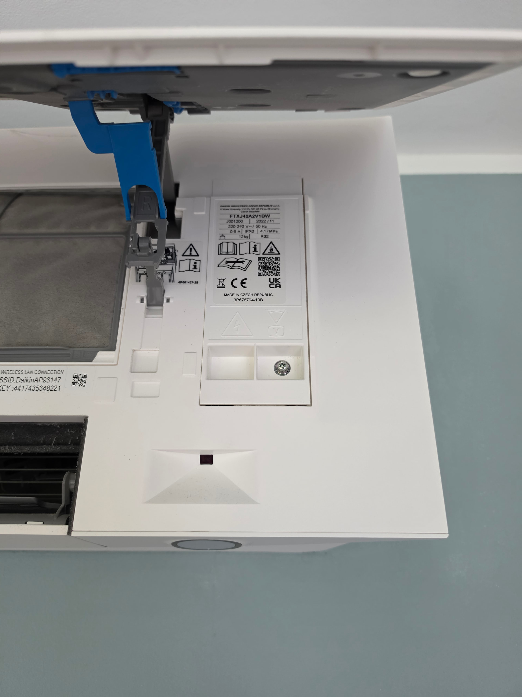</a>

2. **Remove three screws** - One for the maintenance cover (right side), two for the housing hidden under small covers on the left and right sides. Pry the covers with a screwdriver, rotate the air flow wing manually if needed.

   <a href="img/emura3/02.jpeg">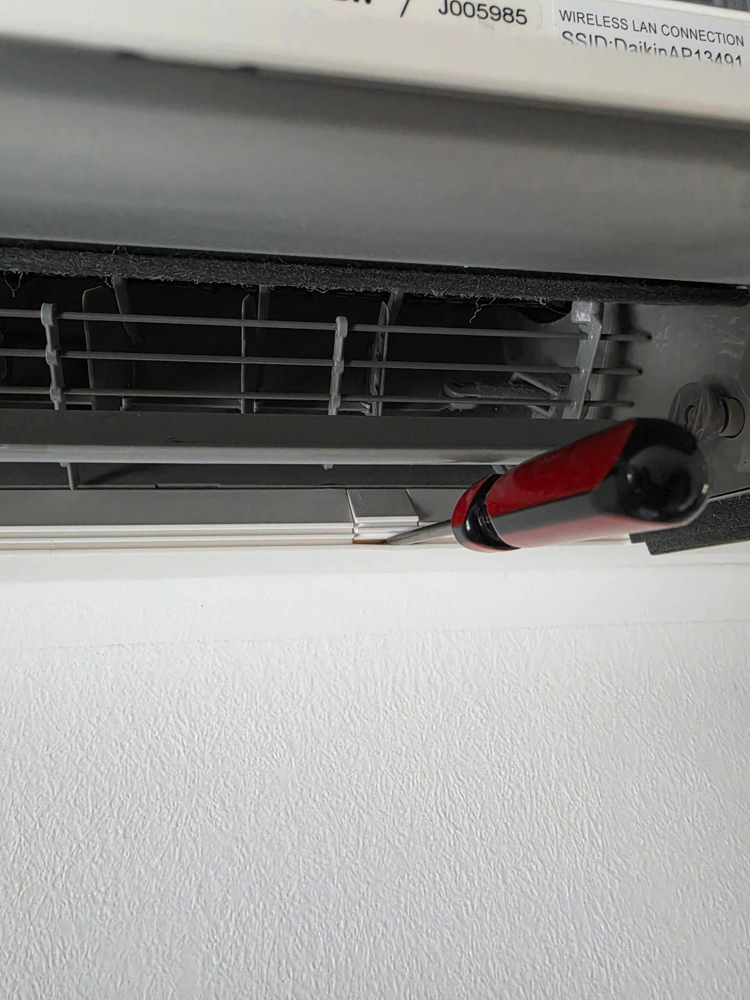</a> <a href="img/emura3/03.jpeg">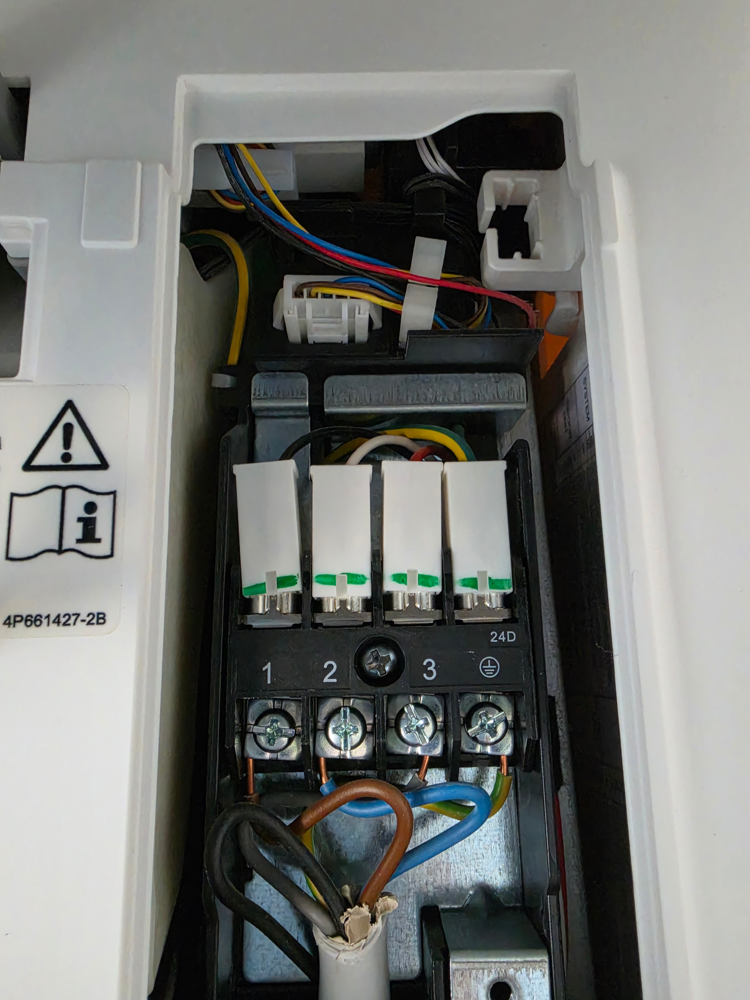</a>

   
<small>⚠️ <em>Note: Cable type and routing should be verified against local regulations – a flexible cable (e.g. H07RN-F) may be required.</em></small>

3. **Disconnect front panel cable** - Locate the white connector with colored wires at the locking mechanism and disconnect it.

   <a href="img/emura3/04.jpeg">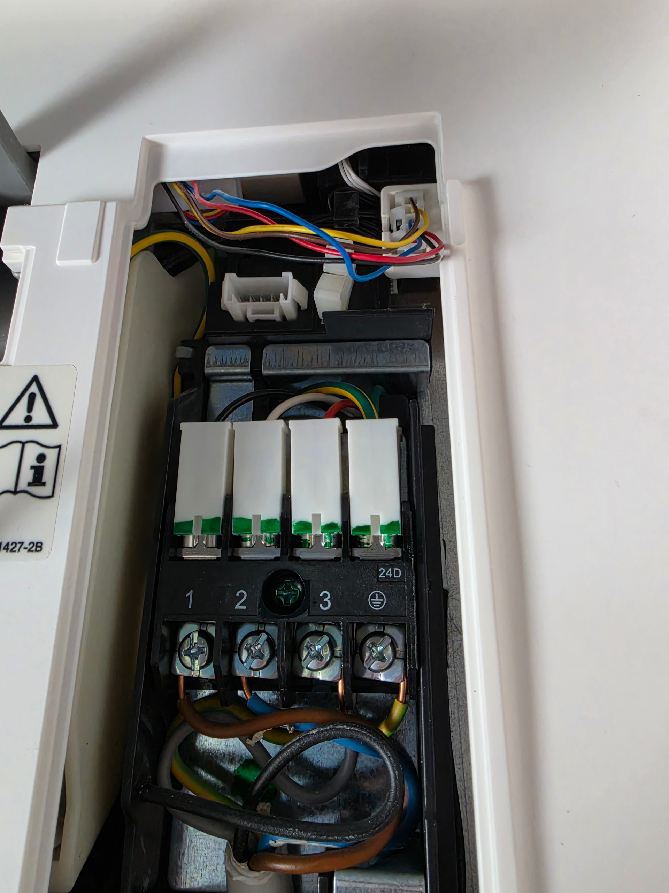</a>

   
<small>⚠️ <em>Note: Cable type and routing should be verified against local regulations – a flexible cable (e.g. H07RN-F) may be required.</em></small>

4. **Remove main housing** - Lift from three hooks (left, center, right) at the top by pressing against the wall, then lift and move rightward. Extract the housing with the front panel forward.

   <a href="img/emura3/05.jpeg">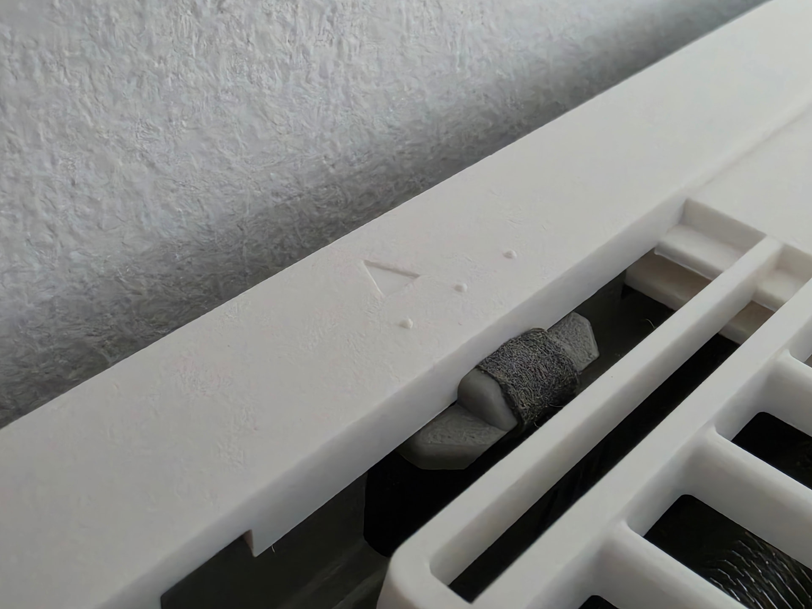</a> <a href="img/emura3/06.jpeg">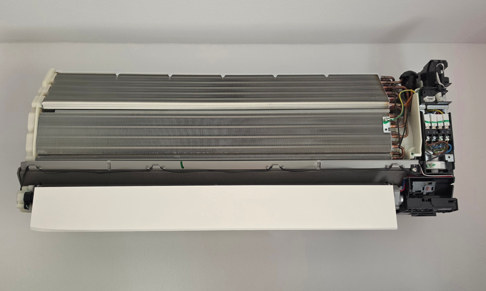</a>

5. **Access the S21 connector** - Remove the single screw on the right-side outer cover, flip and remove the cover. The white S21 port is on the upper board edge beside the blue connector. Route a 40 cm cable through the lower edge beneath the cover.

   <a href="img/emura3/07.jpeg">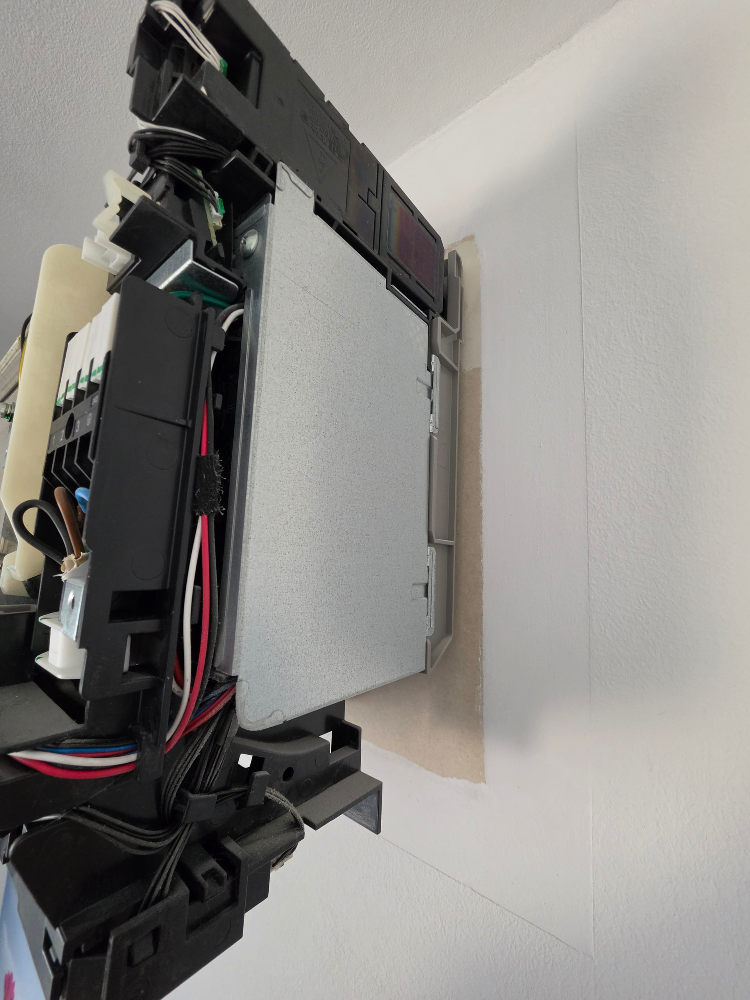</a> <a href="img/emura3/08.jpeg">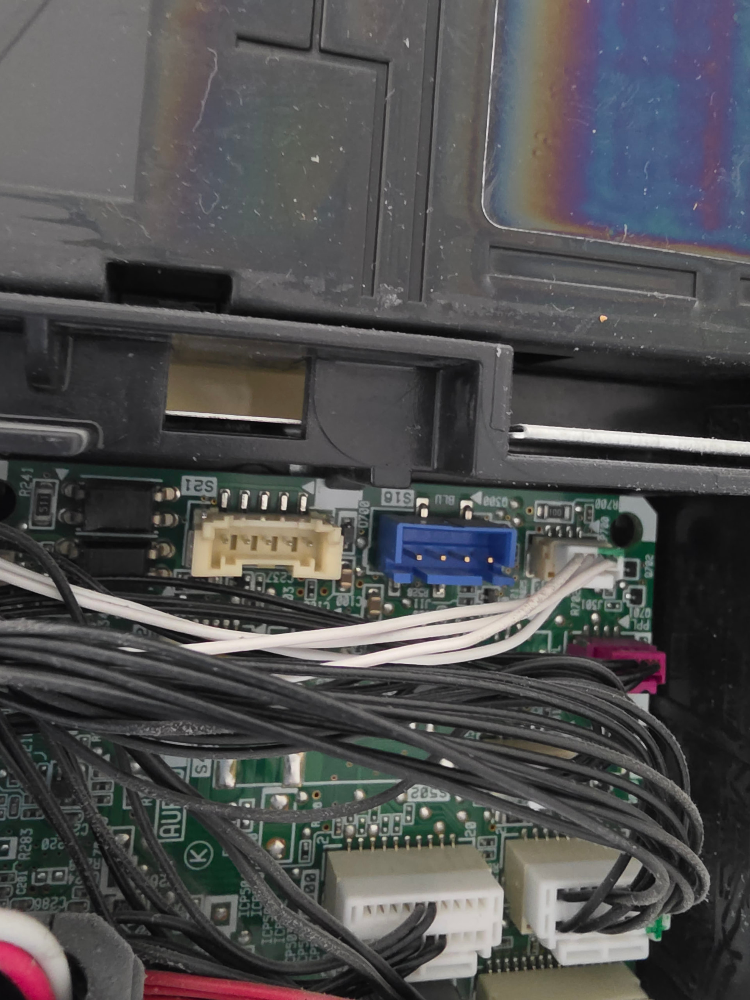</a>

### Placing the Faikout module

6. **Modify the maintenance cover** - Remove the inner metal lining, remove one plastic slat, and cut an opening at the top for the cable.

   <a href="img/emura3/09.jpeg">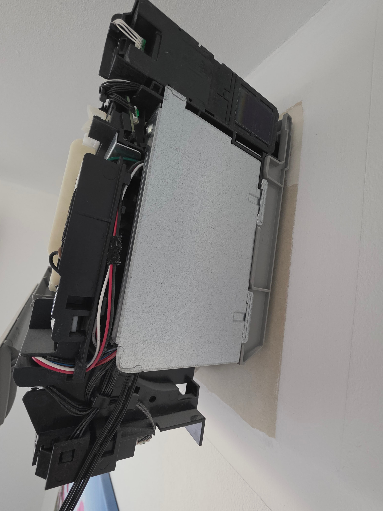</a> <a href="img/emura3/10.jpeg">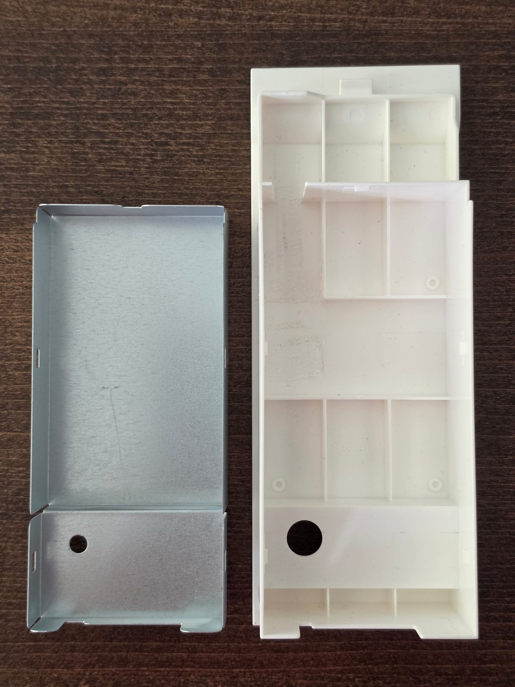</a>

7. **Place the Faikout** in the gap with solder contacts facing down and chip facing up. Add a cardboard insulation layer with tape.

   <a href="img/emura3/11.jpeg">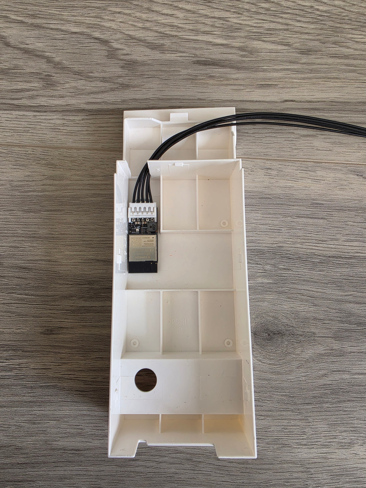</a>

8. **Reinstall maintenance cover** - Route the cable through the gap beside the power connections.

   <a href="img/emura3/12.jpeg">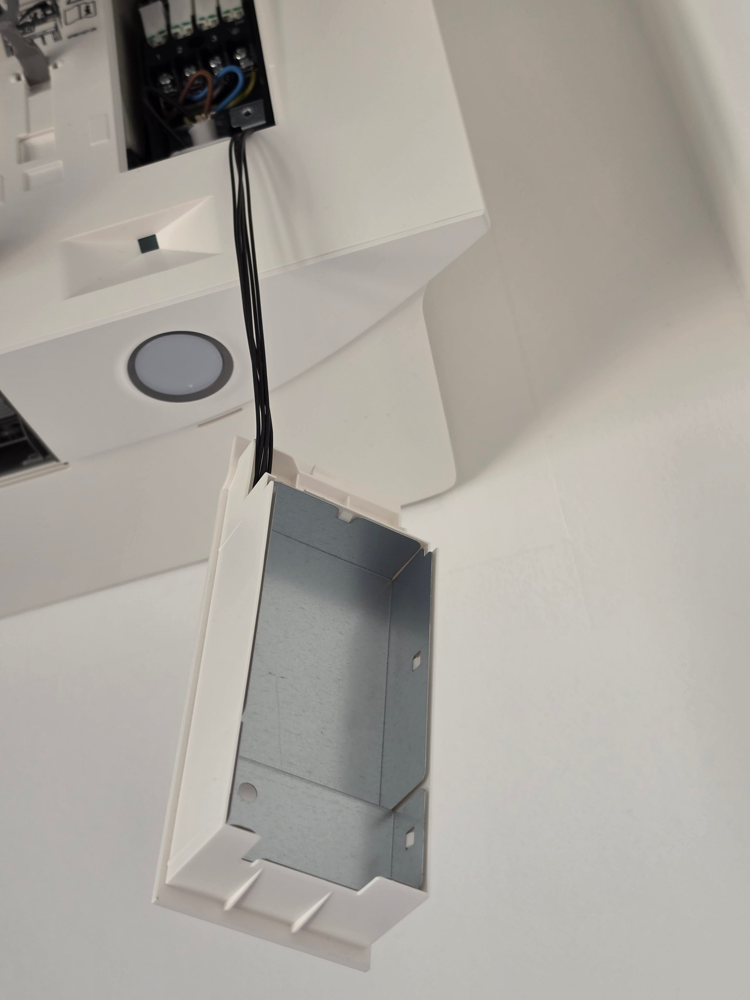</a>

### Closing the unit

Reattach the housing diagonally from below so the cable feeds through the maintenance opening. Re-engage the upper hooks, install the two lower screws with covers, and reconnect the front panel motor cable. Reset the air flow wings manually, then close the front panel via the app.

*Photos: Thanks to Witti*

---

## Deutsch

*Diese Hinweise basieren auf Erfahrungen aus der Community und dienen als hilfreiche Orientierung. Vor dem Öffnen des Geräts immer Strom abschalten und Außengerät vom Netz trennen.*

> **⚠️ Sicherheit zuerst:** Alle Innengeräte ausschalten und das Außengerät vom Strom trennen (Stecker ziehen oder Sicherungsautomat abschalten), bevor mit der Arbeit begonnen wird.

Gilt für: FTXJ25A2V1BW, FTXJ35A2V1BW, FTXJ42A2V1BW (2022) und ähnliche Emura-3-Modelle.  
Kabeltyp: **JST PAP / S21** (Typ B).

Die Emura 3 erfordert vollständigen Gehäuseausbau. Das Frontpanel wird motorgetrieben und muss vor dem Einbau per App geöffnet werden.

### Gehäuse öffnen

1. **Frontpanel per App öffnen** - Einstellungen → Erweiterte Modi → Frontpanel → Öffnen. Vollständig ausfahren bis die blaue Rastklammer einrastet. Filter entnehmen.

   

2. **Drei Schrauben entfernen** - Eine für die Wartungsabdeckung (rechts), zwei für das Gehäuse unter kleinen Abdeckungen links und rechts. Abdeckungen mit Schraubenzieher abhebeln, Luftleitschaufel ggf. manuell drehen.

    

   
<small>⚠️ <em>Hinweis: Leitungstyp und Verlegung sind nach lokalen Normen zu prüfen – ggf. ist eine flexible Leitung (z. B. H07RN-F) vorgeschrieben.</em></small>

3. **Frontpanel-Kabel trennen** - Den weißen Stecker mit farbigen Kabeln am Riegelmechanismus abziehen.

   

   
<small>⚠️ <em>Hinweis: Leitungstyp und Verlegung sind nach lokalen Normen zu prüfen – ggf. ist eine flexible Leitung (z. B. H07RN-F) vorgeschrieben.</em></small>

4. **Hauptgehäuse abnehmen** - An drei Haken (links, Mitte, rechts) oben aushängen: gegen die Wand drücken, nach oben heben und nach rechts bewegen. Gehäuse mit Frontpanel nach vorne herausziehen.

    

5. **S21-Anschluss freilegen** - Einzelne Schraube der rechten Außenabdeckung lösen, Abdeckung aufklappen und entnehmen. Der weiße S21-Anschluss befindet sich an der oberen Platinenkante neben dem blauen Stecker. Ein 40-cm-Kabel durch den unteren Rand unterhalb der Abdeckung führen.

    

### Faikout-Modul platzieren

6. **Wartungsabdeckung modifizieren** - Innere Metallverkleidung entfernen, eine Kunststofflamelle herausnehmen, oben eine Öffnung für das Kabel ausschneiden.

    

7. **Faikout einlegen** - Lötpunkte nach unten, Chip nach oben. Eine Kartonlage als Isolierung mit Klebeband befestigen.

   

8. **Wartungsabdeckung einsetzen** - Kabel durch die Aussparung neben den Stromanschlüssen führen.

   

### Gehäuse schließen

Gehäuse von unten diagonal ansetzen, damit das Kabel durch die Wartungsöffnung geführt wird. Obere Haken einrasten, zwei untere Schrauben mit Abdeckungen einsetzen, Frontpanel-Motorkabel wieder anschließen. Luftleitschaufeln manuell zurücksetzen, Frontpanel per App schließen.

*Fotos: Thanks to Witti*
