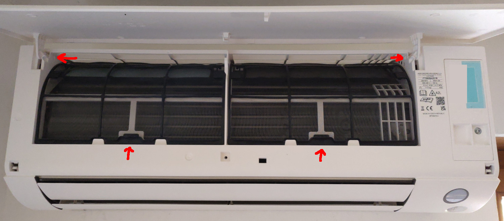
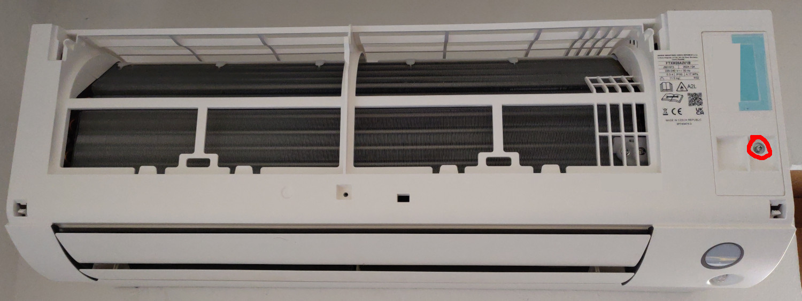
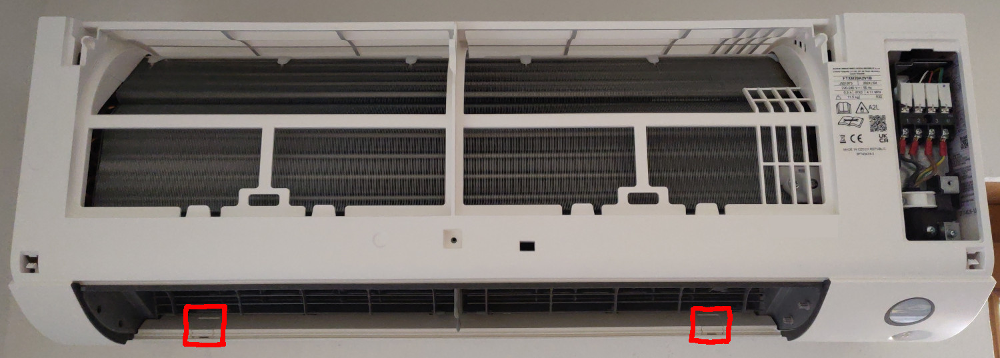
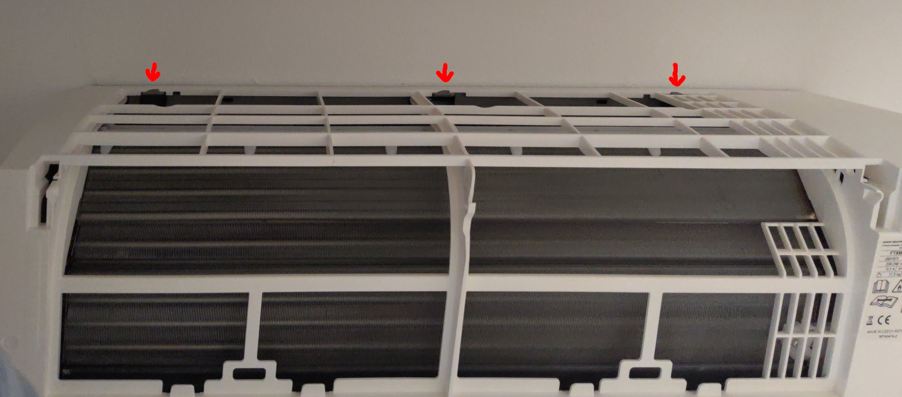
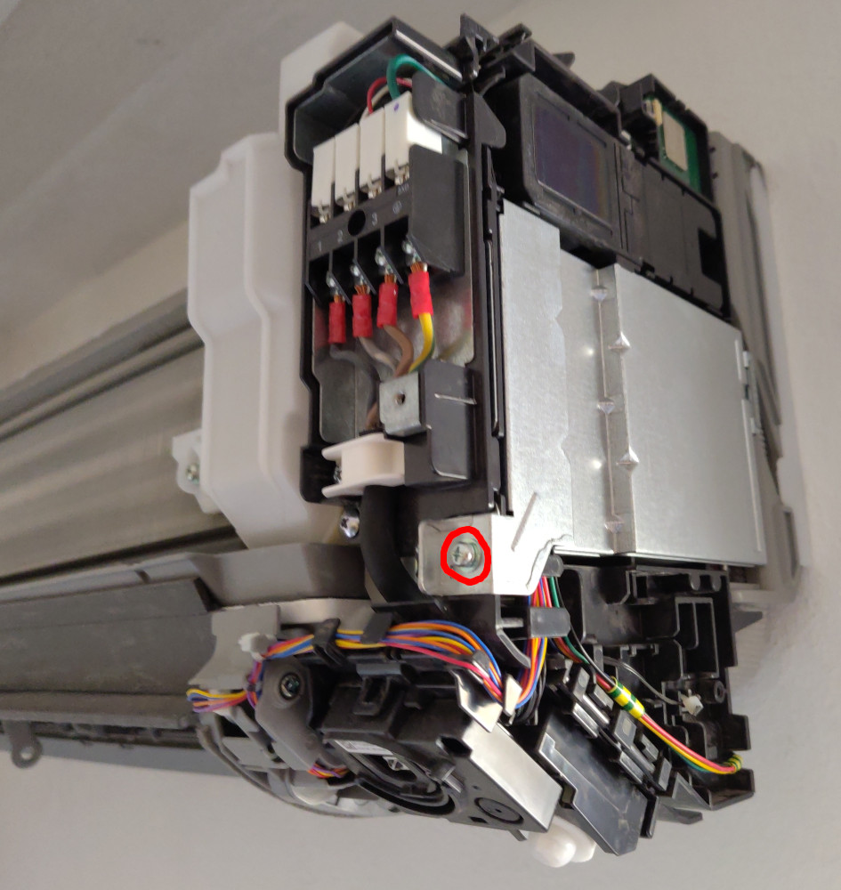
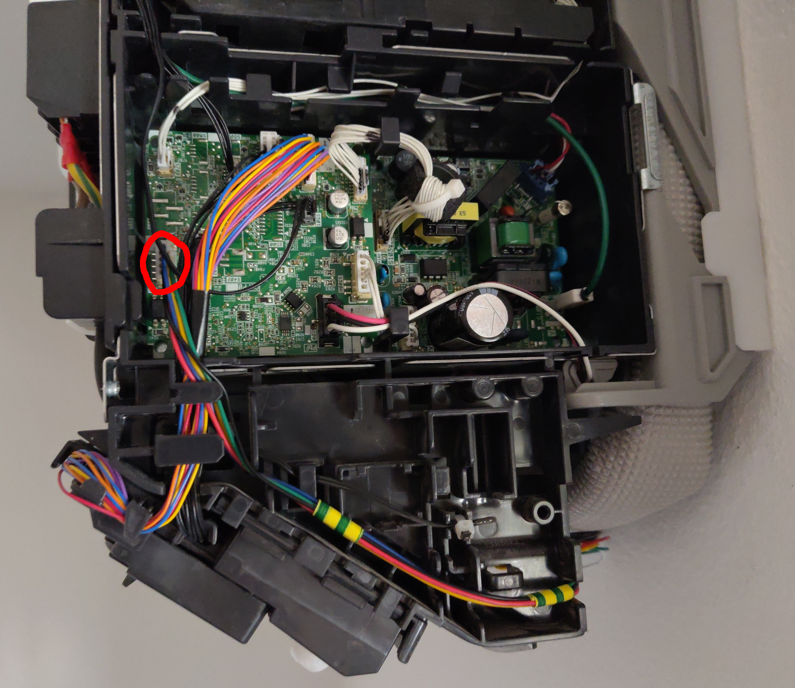

# Daikin Perfera – Disassembly & Installation / Montagehinweise

[English](#english) | [Deutsch](#deutsch)

← [Back to overview / Zurück zur Übersicht](../README.md)

---

## English

*These hints are based on community experience and are provided as a helpful starting point. Always switch off the unit and disconnect the power before opening any housing.*

> **⚠️ Safety first:** Turn off all indoor units and unplug the outdoor unit or trip the circuit breaker before starting any work.

Applies to: CTXM-A, FTXM-A, ATXM-A series (15A – 50A).  
Cable type: **JST PAP / S21** (Type B).

### Opening the unit

1. **Lid and filters** - Swing the lid upward until it unclips, then lift it off. Pull the filters straight down and out.

   

2. **Maintenance cover** - One screw on the right side (PH2). The plastic flap can be bent and slid out by pushing it left or right.

   

3. **Screw covers** - Two small snap-on covers hide screws on the front casing. Lift them out of their grooves with a fingernail. Remove both screws.

   

4. **Main casing** - Three grey hooks on the back plate are the release points. Pull the casing upward rather than pushing down - this is much easier.

   

5. **Electronics cover** - One screw, then slide the cover to the right to remove it.

   

6. **S21 connector** - Now accessible. Route the Faikout cable underneath the electronics, alongside the power cables.

   

### Closing the unit

Reassemble in reverse order. Make sure all hooks click back into place before replacing the screws.

*Photos: www.yepoleb.at / Gabriel Huber*

---

## Deutsch

*Diese Hinweise basieren auf Erfahrungen aus der Community und dienen als hilfreiche Orientierung. Vor dem Öffnen des Geräts immer Strom abschalten und Außengerät vom Netz trennen.*

> **⚠️ Sicherheit zuerst:** Alle Innengeräte ausschalten und das Außengerät vom Strom trennen (Stecker ziehen oder Sicherungsautomat abschalten), bevor mit der Arbeit begonnen wird.

Gilt für: CTXM-A, FTXM-A, ATXM-A Serie (15A – 50A).  
Kabeltyp: **JST PAP / S21** (Typ B).

### Gehäuse öffnen

1. **Deckel und Filter** - Deckel nach oben schwenken bis er ausrastet, abheben. Filter nach unten herausziehen.

   

2. **Wartungsabdeckung** - Eine Schraube rechts (PH2). Die Plastiklasche lässt sich durch Biegen und seitliches Verschieben (links oder rechts) herausnehmen.

   

3. **Schraubenabdeckungen** - Zwei kleine Schnappabdeckungen verbergen Schrauben an der Frontverkleidung. Mit dem Fingernagel aus den Führungen heben, dann beide Schrauben entfernen.

   

4. **Hauptgehäuse** - Drei graue Haken an der Rückplatte sind die Lösepunkte. Das Gehäuse nach oben ziehen statt nach unten drücken - deutlich einfacher.

   

5. **Elektronikabdeckung** - Eine Schraube, dann die Abdeckung nach rechts schieben.

   

6. **S21-Stecker** - Nun zugänglich. Das Faikout-Kabel unterhalb der Elektronik entlangführen, neben den Stromkabeln.

   

### Gehäuse schließen

In umgekehrter Reihenfolge zusammenbauen. Sicherstellen, dass alle Haken einrasten, bevor die Schrauben eingedreht werden.

*Fotos: www.yepoleb.at / Gabriel Huber*

---

<small><em>All information is provided for educational purposes based on community experience. No liability is accepted for errors, omissions, or any damage resulting from the use of this information. Always follow applicable local regulations, standards, and safety requirements. Work on electrical installations must only be carried out by qualified personnel. / Alle Informationen basieren auf Erfahrungen aus der Community und dienen ausschließlich zu Informationszwecken. Es wird keine Haftung für Fehler, Auslassungen oder Schäden übernommen, die aus der Nutzung entstehen. Einschlägige lokale Vorschriften, Normen und Sicherheitsanforderungen sind stets einzuhalten. Arbeiten an elektrischen Anlagen dürfen nur von qualifiziertem Fachpersonal durchgeführt werden.</em></small>
