# Getting started with Faikout / Einstieg mit dem Faikout

[English](#english) | [Deutsch](#deutsch)

← [Back to overview / Zurück zur Übersicht](../README.md)

---

## English

*This guide is a best-effort introduction based on personal experience, including subjective impressions and assessments. It makes no claim to completeness or perfection and is offered as a helpful starting point.*

- [Operating modes](#operating-modes)
  - [Mode 1: Interface mode](#mode-1-interface-mode)
  - [Mode 2: Control mode](#mode-2-control-mode)
- [WiFi setup](#wifi-setup)
  - [Via Android smartphone](#via-android-smartphone)
  - [Via Windows PC](#via-windows-pc)
- [Home Assistant integration](#home-assistant-integration)

> Note: The module was renamed from "Faikin" to "Faikout" in November 2025. Older sources or screenshots may still show "Faikin" – it is the same module.

### Operating modes

The Faikout module can be operated in two modes that differ in configuration and behaviour.

#### Mode 1: Interface mode

In interface mode the Faikout provides access to the Daikin air conditioner via its web interface and the standardised MQTT interface. The module itself makes no automatic interventions – this is an important distinction from Mode 2.

Communication with the Daikin unit is bidirectional via S21 (the serial interface used by Daikin units to communicate with their own control components). Settings from other sources (e.g. the Onecta app or the remote control) are also reflected by the Faikout.

This mode is recommended when you want to continue using the original remote control. It is also the right choice for advanced setups where an external automation system provides additional control logic on top of the Daikin's own regulation.

The upper part of the Faikout web interface represents Interface mode:

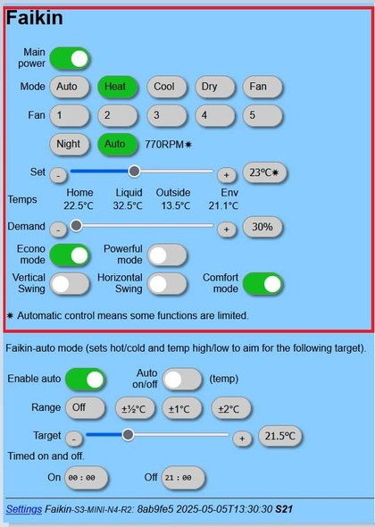

#### Mode 2: Control mode

Control mode adds extra regulation functions that run "piggyback" on top of the Daikin's own regulation (which cannot be disabled). There are two sub-modes:

##### A) AutoControl

The Faikout uses its own control algorithm, which can be parameterised in the module. This makes it possible to connect an external temperature sensor so that the air conditioner reacts more realistically to the actual room temperature.

Note that because this is a second-instance controller on top of the Daikin's own regulation, relatively large setpoint jumps of several °C may be necessary before the Daikin responds at all.

As a result, the original Daikin regulation parameters are automatically overridden by the Faikout, and manual adjustments via the remote control are counterproductive. Switching on/off can still be done via the remote control, but the setpoint temperature should be adjusted exclusively via the Faikout parameters.

The lower part of the Faikout web interface represents Control mode (AutoControl):

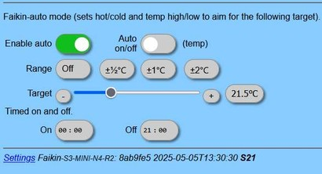

##### B) Thermostat mode

In addition to AutoControl, a simpler thermostat mode is available in Mode 2. This is a basic two-point controller that regulates the setpoint (`autot`) within a band/hysteresis (`autor`), also taking an external temperature sensor into account.

<a href="img/thermostat-diagram.jpeg">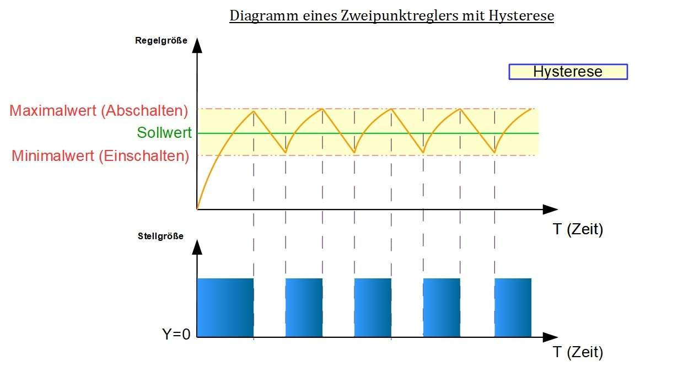</a>

The thermostat mode is often described as easier to understand and more predictable in use. To use it instead of the more complex AutoControl function, activate it in the Faikout configuration menu:

---

### WiFi setup

On first boot the Faikout opens a WiFi access point. Connect any device to this access point to enter your WiFi credentials.

#### Via Android smartphone

The Faikout access point appears in the WiFi list as `Faikin-XXXXXXXX` (or `Faikout-XXXXXXXX`):

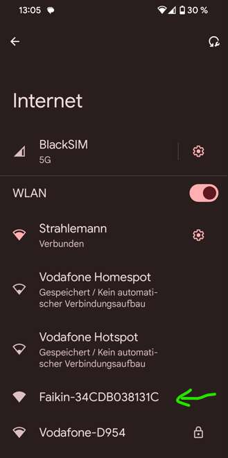

Connect to it. The login page usually opens automatically:

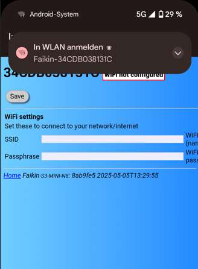

If the login page does not appear, Android may show a "Sign in to network" notification – tap it. Alternatively open the WiFi connection details:

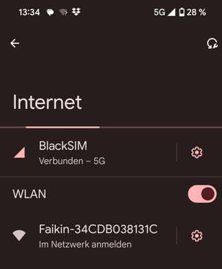

Then tap the **Sign in** button in the network details:

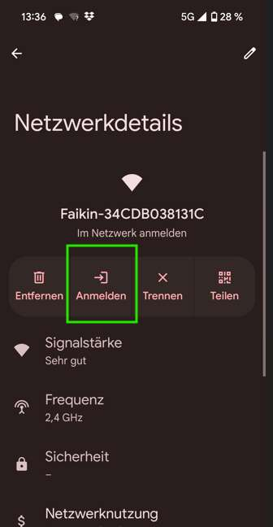

Enter SSID and passphrase of your home network and save.

> **Tip:** If Android reports "no internet" and asks whether to keep the connection – confirm to keep it.

#### Via Windows PC

Connect to the Faikout access point in the Windows WiFi settings:

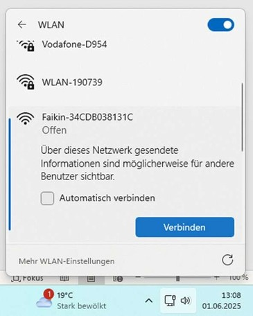

Once connected, click the info icon (ⓘ) next to the network:

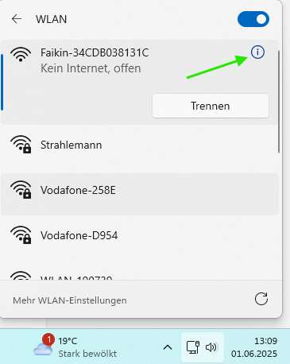

In the network details, the **IPv4 default gateway** is the Faikout's IP address:

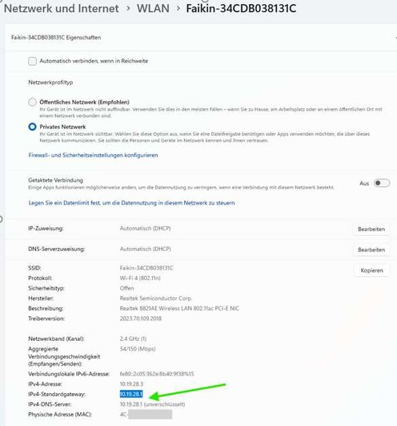

Open that IP in a browser to reach the Faikout WiFi configuration page:

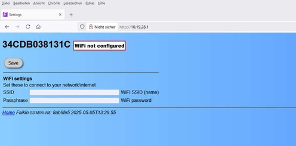

Enter SSID and passphrase, save. The Faikout restarts and is available in your network at its new IP or hostname (e.g. `34CDB038131C.local`).

> **Note:** The Faikout responds poorly to simultaneous requests from multiple devices or browser tabs. Always use only one browser tab when accessing the web interface.

---

### Home Assistant integration

In the Faikout web interface, enable the **Home Assistant** toggle:

Then enter your MQTT broker details:

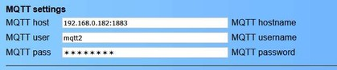

Save – the Faikout registers itself automatically in Home Assistant via MQTT autodiscovery and appears as a climate entity with sensors:

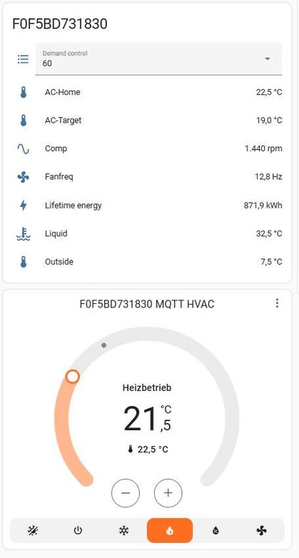

---

## Deutsch

*Diese Beschreibung entstand nach bestem Wissen und Gewissen inklusive möglicher subjektiver Erfahrungen und Wertungen. Sie erhebt keinen Anspruch auf Vollständigkeit oder Perfektion und versteht sich als Angebot zur Orientierung.*

- [Betriebsmodi](#betriebsmodi)
  - [Modus 1: Interfacemodus](#modus-1-interfacemodus)
  - [Modus 2: Regelbetrieb](#modus-2-regelbetrieb)
- [WLAN-Einrichtung](#wlan-einrichtung)
  - [Weg über Smartphone (Android)](#weg-über-smartphone-android)
  - [Weg über Windows-PC](#weg-über-windows-pc)
- [Home Assistant Integration](#home-assistant-integration-1)

> Hinweis: Das Modul wurde im November 2025 von "Faikin" in "Faikout" umbenannt. In älteren Quellen oder Screenshots kann noch "Faikin" auftauchen – gemeint ist dasselbe Modul.

### Betriebsmodi

Das Faikout-Modul lässt sich in zwei Modi betreiben, die man in ihrer Konfiguration und Bedienung unterscheiden sollte.

#### Modus 1: Interfacemodus

Im Interfacemodus bietet das Faikout-Modul eine ergänzende Möglichkeit auf die Daikin-Klimaanlage zuzugreifen – über die Weboberfläche und die standardisierte MQTT-Schnittstelle. Das Modul selbst führt dabei keine automatisierten Eingriffe aus – das ist ein wesentlicher Unterschied zu Modus 2.

Die Kommunikation zur Daikin-Anlage findet bidirektional über S21 statt. Auch Einstellungen, die von einer anderen Quelle stammen (z. B. der Onecta-App oder der Fernbedienung), werden vom Faikout dargestellt.

Dieser Modus ist empfehlenswert, wenn man die originale Fernbedienung weiterhin nutzen möchte. Er eignet sich auch für ausgeprägte Lösungen, bei denen eine externe Regelung zusätzlich auf die Daikin-Regelung aufgeschaltet wird.

Der obere Teil der Faikout-Weboberfläche repräsentiert den Interfacemodus:

#### Modus 2: Regelbetrieb

Das Faikout-Modul bietet die Möglichkeit, zusätzliche Regelfunktionen „huckepack" zur Daikin-Regelung (nicht abschaltbar) zu nutzen. Es gibt zwei Untermodi:

##### A) AutoControl

In dieser Regelfunktion nutzt das Faikout einen eigenen Regelalgorithmus, der im Modul parametriert werden kann. Dadurch besteht die Möglichkeit, einen externen Temperatursensor einzubinden, damit die Klimaanlage realistischer auf die tatsächliche Raumtemperatur reagiert.

Zu beachten ist, dass der Faikout-Regler teils stark eingreifen muss, damit die Daikin-Regelung überhaupt reagiert. Die Solltemperatur sollte daher ausschließlich über die Faikout-Parameter eingestellt werden – manuelle Änderungen per Fernbedienung sind kontraproduktiv.

Der untere Teil der Faikout-Weboberfläche repräsentiert den Regelbetrieb (AutoControl):

##### B) Thermostatmodus

Ergänzend zum AutoControl-Betrieb ist im Modus 2 auch ein einfacherer Thermostatmodus nutzbar. Hierbei handelt es sich um einen simplen Zweipunktregler, der den Sollwert (`autot`) in einem Band/Hysterese (`autor`) regelt.

Der Thermostatmodus wird oft als leichter verständlich und besser vorhersehbar beschrieben. Um ihn anstelle der komplexeren AutoControl-Funktion zu nutzen, ist er im Konfigurationsmenü zu aktivieren:

---

### WLAN-Einrichtung

Bei Erstinbetriebnahme öffnet das Faikout-Modul einen WLAN-Access-Point. Man verbindet sich mit einem beliebigen Gerät damit, um die WLAN-Zugangsdaten einzutragen.

#### Weg über Smartphone (Android)

Der Faikout Access Point erscheint in der WLAN-Liste als `Faikin-XXXXXXXX` (oder `Faikout-XXXXXXXX`):

Verbindung herstellen. Im Normalfall öffnet sich die Anmeldeseite automatisch:

Falls die Anmeldeseite nicht erscheint, zeigt Android ggf. eine Benachrichtigung „Im WLAN anmelden". Alternativ die WLAN-Verbindungsdetails aufrufen:

In den Netzwerkdetails den **Anmelden**-Button antippen:

SSID und Passwort des Heimnetzwerks eintragen und speichern.

> **Hinweis:** Meldet Android „keine Internetverbindung" – die Verbindung dennoch bestätigen und aufrechterhalten.

#### Weg über Windows-PC

Verbindung zum Faikout Access Point in den Windows WLAN-Einstellungen herstellen:

Nach der Verbindung das Info-Symbol (ⓘ) neben dem Netzwerk anklicken:

In den Netzwerkdetails ist der **IPv4-Standardgateway** die IP-Adresse des Faikout:

Diese IP im Browser aufrufen – die Faikout-WLAN-Konfigurationsseite erscheint:

SSID und Passwort eintragen, speichern. Das Faikout startet neu und ist im Netzwerk unter seiner neuen IP oder dem Hostnamen erreichbar (z. B. `34CDB038131C.local`).

> **Hinweis:** Das Faikout reagiert bei gleichzeitigen Zugriffen von mehreren Geräten oder Browser-Tabs sensibel. Immer nur einen Webzugriff gleichzeitig verwenden.

---

### Home Assistant Integration

Im Faikout-Webinterface den **Home Assistant**-Schalter aktivieren:

Anschließend die MQTT-Broker-Daten eintragen:

Speichern – das Faikout registriert sich automatisch in Home Assistant über MQTT-Autodiscovery und erscheint als Klimaentität mit Sensoren:

