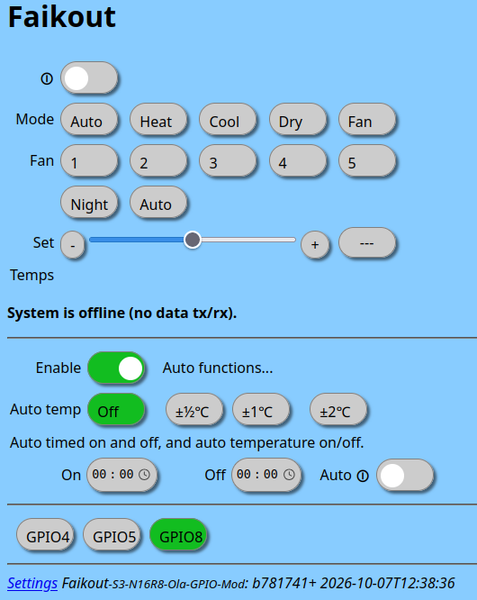
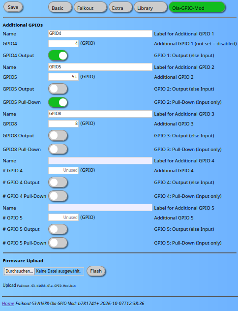

# faikout-Modifications

[English](#english) | [Deutsch](#deutsch)

---

## English

Rough Faikout firmware modifications to fulfill individual demands. No ongoing support or maintenance.

More information about the Faikout itself: [codeberg.org/RevK/ESP32-Faikout](https://codeberg.org/RevK/ESP32-Faikout)

### Contents

- [Faikout-Ola-GPIO-MOD](#faikout-ola-gpio-mod)

---

### Faikout-Ola-GPIO-MOD

Firmware modification adding 5 configurable additional GPIOs (input/output) with individual names, web UI controls, and MQTT integration. Because of hardware requirements (usable GPIOs) standard ESP32 developer boards are used (note: voltage supply and signal adaptation to the Daikin board required). No OTA updates from the Faikout source can be applied - this will destroy the modification.

**Precompiled hardware options:**
| Board | Build suffix | Factory firmware (flash 0x0) | Update firmware (flash 0x10000) |
|---|---|---|---|
| ESP32-S3-N16R8 | `Faikout-S3-N16R8-Ola-GPIO-Mod` | [factory.bin](https://codeberg.org/RaW07/faikout-Modifications/releases/download/v1.3/Faikout-S3-N16R8-Ola-GPIO-Mod-factory.bin) | [update.bin](https://codeberg.org/RaW07/faikout-Modifications/releases/download/v1.3/Faikout-S3-N16R8-Ola-GPIO-Mod.bin) |
| ESP32-S3-N8R2 | `Faikout-S3-N8R2-Ola-GPIO-Mod` | [factory.bin](https://codeberg.org/RaW07/faikout-Modifications/releases/download/v1.3/Faikout-S3-N8R2-Ola-GPIO-Mod-factory.bin) | [update.bin](https://codeberg.org/RaW07/faikout-Modifications/releases/download/v1.3/Faikout-S3-N8R2-Ola-GPIO-Mod.bin) |

**Features:**
- Custom settings tab "Ola-GPIO-Mod" for GPIO configuration and OTA firmware upload
- Main page third section: GPIO status buttons (horizontal, green = ON); PWM outputs show a 0-100% slider; ADC inputs show a read-only percentage
- MQTT control: `command/xgpioN` (payload `1`/`0` for digital, `0`-`100` for PWM) and state report on `state/xgpio`
- PWM mode per output GPIO with configurable frequency (Hz)
- ADC mode per input GPIO: analog value reported as 0-100% (periodic + on change, configurable threshold)
- Digital inputs: GPIO interrupt (ANYEDGE) for immediate change detection, MQTT update within 1 second
- Home Assistant MQTT discovery: named xgpios auto-register as switch / binary_sensor / number / sensor depending on mode; re-registers on config change
- Real-time WebSocket status updates
- Auto-OTA disabled to prevent overwriting the modified firmware

<table><tr>
<td></td>
<td></td>
</tr></table>

---

## Deutsch

Grobe Faikout-Firmware-Modifikationen für individuelle Anforderungen. Kein laufender Support oder Pflege.

Weitere Informationen zum Faikout selbst: [codeberg.org/RevK/ESP32-Faikout](https://codeberg.org/RevK/ESP32-Faikout)

### Inhalt

- [Faikout-Ola-GPIO-MOD](#faikout-ola-gpio-mod-1)

---

### Faikout-Ola-GPIO-MOD

Firmware-Modifikation mit 5 konfigurierbaren zusätzlichen GPIOs (Ein-/Ausgang) mit individuellen Namen, Web-UI-Steuerung und MQTT-Integration. Aufgrund von Hardware-Anforderungen (nutzbare GPIOs) werden Standard-ESP32-Entwicklerboards verwendet (Spannungsversorgung und Signalanpassung zur Daikin bitte beachten). OTA-Updates aus der Faikout-Quelle können nicht eingespielt werden - dies zerstört die Modifikation.

**Vorkompilierte Hardware-Optionen:**
| Board | Build-Suffix | Factory-Firmware (Flash 0x0) | Update-Firmware (Flash 0x10000) |
|---|---|---|---|
| ESP32-S3-N16R8 | `Faikout-S3-N16R8-Ola-GPIO-Mod` | [factory.bin](https://codeberg.org/RaW07/faikout-Modifications/releases/download/v1.3/Faikout-S3-N16R8-Ola-GPIO-Mod-factory.bin) | [update.bin](https://codeberg.org/RaW07/faikout-Modifications/releases/download/v1.3/Faikout-S3-N16R8-Ola-GPIO-Mod.bin) |
| ESP32-S3-N8R2 | `Faikout-S3-N8R2-Ola-GPIO-Mod` | [factory.bin](https://codeberg.org/RaW07/faikout-Modifications/releases/download/v1.3/Faikout-S3-N8R2-Ola-GPIO-Mod-factory.bin) | [update.bin](https://codeberg.org/RaW07/faikout-Modifications/releases/download/v1.3/Faikout-S3-N8R2-Ola-GPIO-Mod.bin) |

**Funktionen:**
- Eigener Einstellungen-Tab "Ola-GPIO-Mod" für GPIO-Konfiguration und OTA-Firmware-Upload
- Drittes Kapitel auf der Hauptseite: GPIO-Status-Buttons (horizontal, grün = EIN); PWM-Ausgänge zeigen einen 0-100%-Slider; ADC-Eingänge zeigen einen Prozentwert (nur Anzeige)
- MQTT-Steuerung: `command/xgpioN` (Payload `1`/`0` fur digital, `0`-`100` für PWM) und Statusmeldung auf `state/xgpio`
- PWM-Modus je Ausgangs-GPIO mit konfigurierbarer Frequenz (Hz)
- ADC-Modus je Eingangs-GPIO: Analogwert als 0-100% (periodisch + bei Änderung, konfigurierbarer Schwellwert)
- Digitale Eingänge: GPIO-Interrupt (ANYEDGE) für sofortige Zustandserkennung, MQTT-Meldung innerhalb 1 Sekunde
- Home Assistant MQTT Discovery: benannte xgpios registrieren sich automatisch als switch / binary_sensor / number / sensor je nach Modus; erneute Registrierung bei Konfigurationsänderung
- Echtzeit-WebSocket-Statusaktualisierungen
- Auto-OTA deaktiviert, um das modifizierte Firmware nicht zu überschreiben

<table><tr>
<td></td>
<td></td>
</tr></table>

---

<small><em>All information is provided for educational purposes based on community experience. No liability is accepted for errors, omissions, or any damage resulting from the use of this information. Always follow applicable local regulations, standards, and safety requirements. Work on electrical installations must only be carried out by qualified personnel. / Alle Informationen basieren auf Erfahrungen aus der Community und dienen ausschließlich zu Informationszwecken. Es wird keine Haftung für Fehler, Auslassungen oder Schäden übernommen, die aus der Nutzung entstehen. Einschlägige lokale Vorschriften, Normen und Sicherheitsanforderungen sind stets einzuhalten. Arbeiten an elektrischen Anlagen dürfen nur von qualifiziertem Fachpersonal durchgeführt werden.</em></small>
